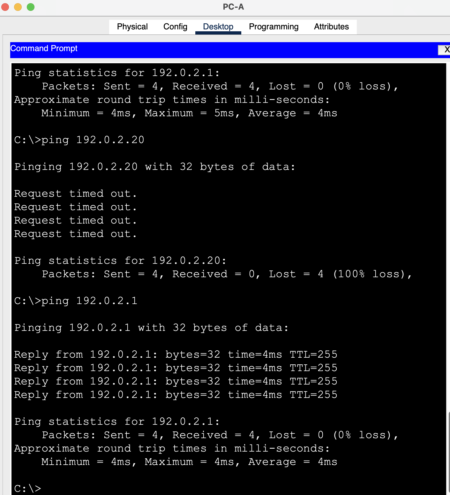
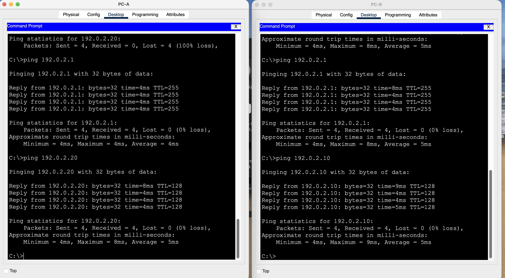
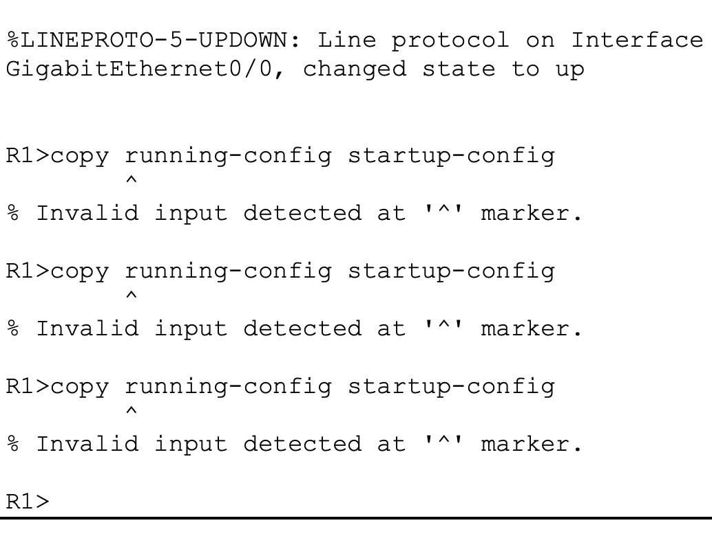

# L01 · Ethernet LAN and disabled access port

**Practical work:** reviewed from learner screenshots dated 23 October 2026. Packet-flow concepts were subsequently resolved with guided review. This is a simulated learning exercise.

## Scenario and addressing

Two PCs share S1 in VLAN 1. R1 provides a local router interface. PC-to-PC traffic stays in the local subnet.

| Device | Interface/link | IPv4 / prefix | Gateway |
|---|---|---|---|
| PC-A | S1 Fa0/1 | 192.0.2.10/24 | 192.0.2.1 |
| PC-B | S1 Fa0/2 | 192.0.2.20/24 | 192.0.2.1 |
| R1 | Gi0/0 to S1 Gi0/1 | 192.0.2.1/24 | — |

## Case 1 · One PC becomes unreachable

**Symptom:** PC-A could still ping R1, while its ping to PC-B failed. The reported injected change was `shutdown` on S1 Fa0/2.

**Diagnosis:** the working router control test showed that PC-A's local branch was still usable. Inspecting PC-B's access interface focused the investigation on the affected endpoint rather than remote routing or DNS.

```text
enable
show interfaces status
show interfaces fastEthernet 0/2
show mac address-table dynamic
configure terminal
interface fastEthernet 0/2
 no shutdown
end
```

`show interfaces status` summarizes the switch ports. The detailed interface command distinguishes administrative state from operational link/protocol state. `no shutdown` removes the administrative disable on this specific port. MAC-table inspection helps relate observed sources to ports; it does not by itself prove that every ping succeeded.



*Fault scope: PC-B does not reply, while the local router remains reachable.*

**Recovery:** Fa0/2 was observed up/up after the correction. The final labeled captures show 4/4 replies for PC-A → PC-B, PC-B → PC-A and both clients → R1.



*Recovery: successful labeled peer and router tests from both PCs.*

## Case 2 · Configuration save rejected

**Symptom:** `copy running-config startup-config` was rejected at the `R1>` prompt. This was an IOS command-mode issue.

**Correction:** enter privileged EXEC using `enable`, confirm the `R1#` prompt, and repeat the save. Accept the default destination filename with Enter.

```text
enable
copy running-config startup-config
```



*Earlier failed save at the user EXEC prompt.*

![Later successful running-to-startup save with [OK].](../images/L01-access-port-2026-10-23-200314-R1-save-success.png)

*Later successful running-to-startup save with [OK].*

Saving IOS configuration and saving the `.pkt` project are separate operations. Preserve both the working baseline and the recovered project.

## Learning outcome and limits

The switch learns source MAC addresses and looks up the destination MAC for forwarding. Local peers do not send their traffic through R1 merely because a gateway is configured. A fresh post-recovery MAC table containing every client was not supplied; the final pings establish connectivity recovery, while earlier captures establish MAC learning.

Projects: [L01-recovered.pkt](../packet-tracer/L01-recovered.pkt) · [L01-disabled-port.pkt](../packet-tracer/L01-disabled-port.pkt) · [L01-baseline.pkt](../packet-tracer/L01-baseline.pkt) · [Command reference](../docs/COMMANDS.md) · [Index](../README.md)
