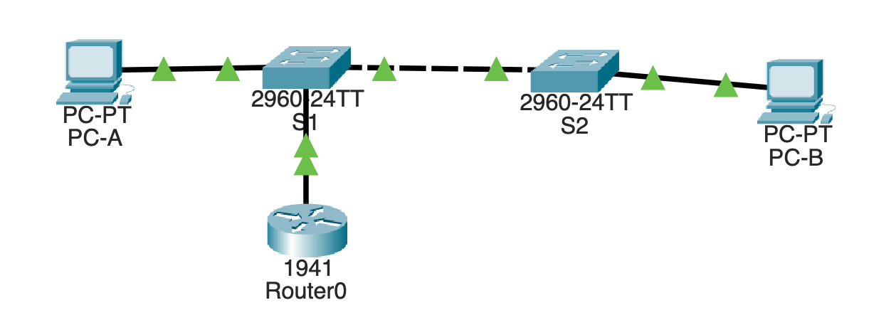
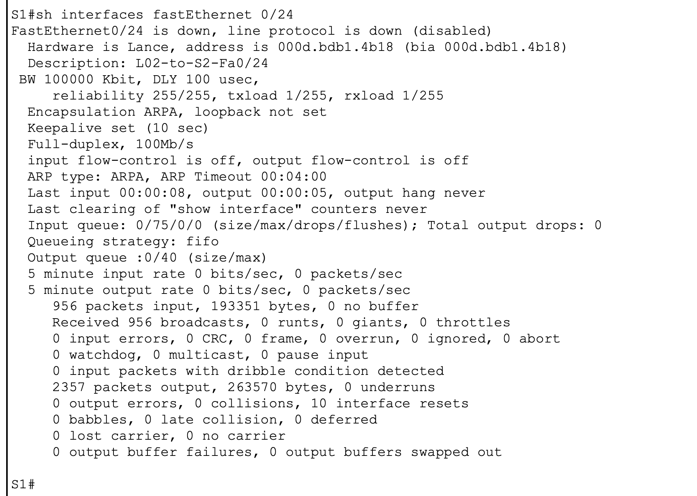
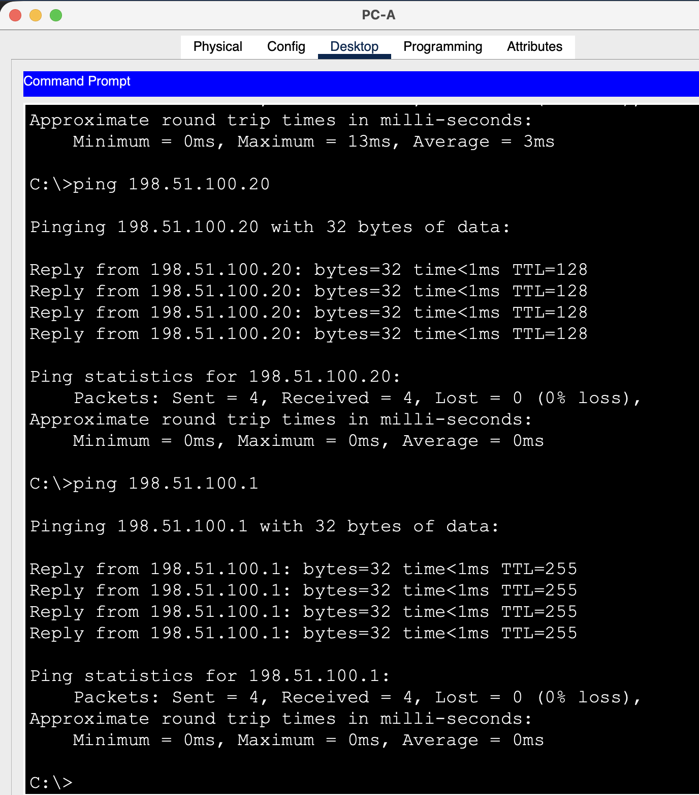
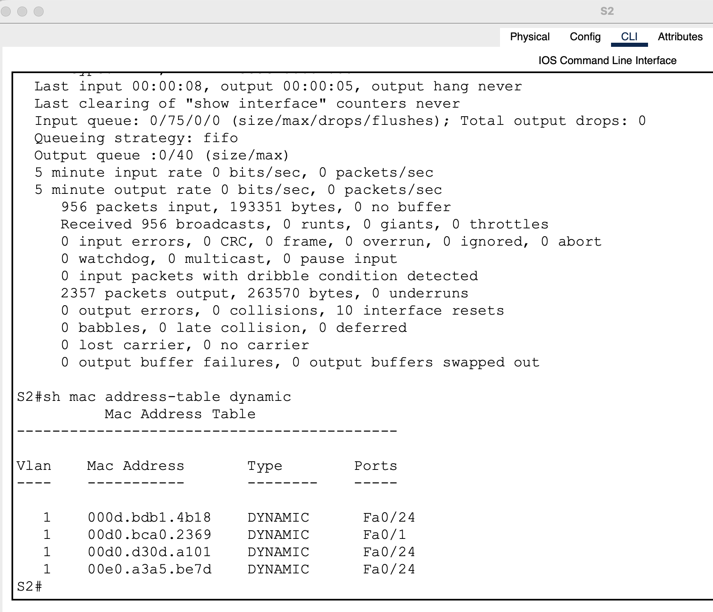

# L02 · Inter-switch uplink failure

**Practical work:** verified from guided learner baseline, fault and recovery evidence dated 25 October 2026.

## Scenario

PC-A and R1 attach to S1. PC-B attaches to S2. S1 Fa0/24 connects to S2 Fa0/24; all used ports are in VLAN 1. These are two switches in one IP subnet, without an additional remote routed network.



*Original lab topology: the inter-switch connection is the shared path to PC-B.*

| Device | Address | Gateway |
|---|---|---|
| R1 Gi0/0 | 198.51.100.1/24 | — |
| PC-A | 198.51.100.10/24 | 198.51.100.1 |
| PC-B | 198.51.100.20/24 | 198.51.100.1 |

## Fault, isolation and solution

Removing the S1–S2 cable interrupted cross-switch connectivity. Both Fa0/24 interface outputs showed down/down. PC-A could still reach R1 on S1, while PC-A → PC-B and PC-B's cross-switch tests failed. The surviving local branch narrowed the fault to the shared uplink.

```text
enable
show interfaces fastEthernet 0/24
show interfaces status
show mac address-table dynamic
```

The detailed interface output provides state, speed and duplex. Compare both ends rather than relying on a single green link indicator. Multiple remote MAC addresses on Fa0/24 are normal when those devices sit behind the other switch.



*S1 Fa0/24 during the cable fault.*

**Repair:** reconnect the original inter-switch ports with the intended Ethernet cable and allow forwarding to resume. `no shutdown` alone cannot replace a missing cable.

## Validation

Repeat the following from the named endpoints:

```text
PC-A: ping 198.51.100.20
PC-A: ping 198.51.100.1
PC-B: ping 198.51.100.10
PC-B: ping 198.51.100.1
```

These labels identify the originating device; type only the command after the colon in its command prompt. All four final tests returned 4/4 replies. S2's recovery capture explicitly shows up/up. S1's recovery status line is cropped, so its recovery is supported by forwarding tests, MAC entries and the visible interface details rather than an invented complete status line.



*PC-A recovery checks to PC-B and R1.*



*S2 learns its local and remote MAC paths after repair.*

**Rollback:** reopen the untouched baseline or reconnect the exact original uplink. The baseline, fault and recovery projects are preserved separately.

Projects: [L02-baseline.pkt](../packet-tracer/L02-baseline.pkt) · [L02-recovered.pkt](../packet-tracer/L02-recovered.pkt) · [L02-uplink-fault.pkt](../packet-tracer/L02-uplink-fault.pkt) · [Command reference](../docs/COMMANDS.md) · [Index](../README.md)
