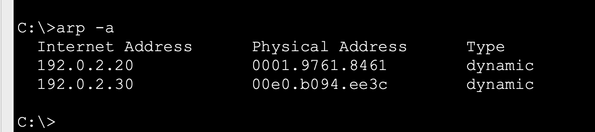
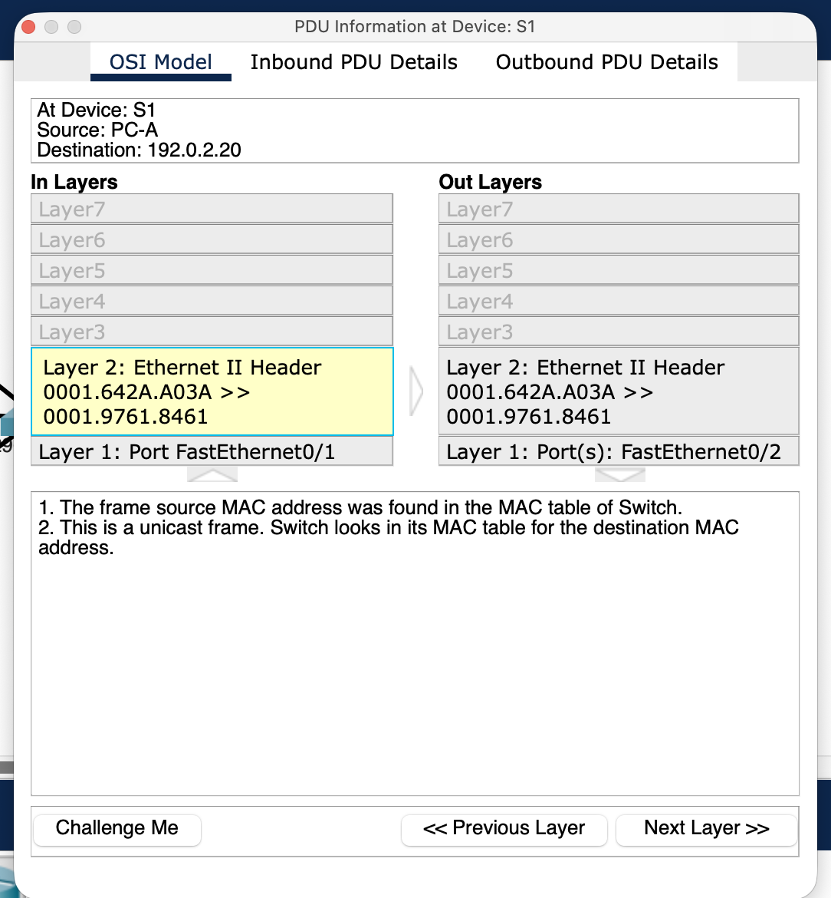
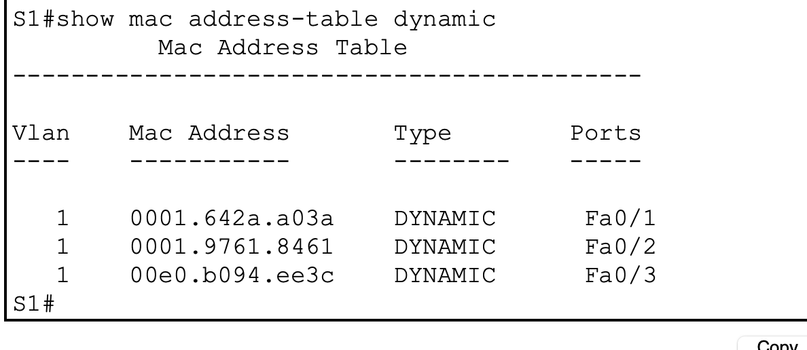

# L03 · ARP, MAC learning and forwarding

**Evidence:** learner captures dated 27 October 2026 support connectivity, ARP mappings, known-unicast forwarding and relearning. This is a controlled learning-state experiment, not a broken link. The missing first unknown-unicast observation was later obtained in [L06](L06-layered-troubleshooting.md#controlled-unknown-unicast-observation).

## Scenario

Three PCs share VLAN 1 on S1. PC-A is 192.0.2.10/24 on Fa0/1, PC-B is 192.0.2.20/24 on Fa0/2, and PC-C is 192.0.2.30/24 on Fa0/3. No router or default gateway is needed for this subnet.

| State table | Location | Mapping | Purpose |
|---|---|---|---|
| ARP cache | PC | Local IPv4 → MAC | Build the frame for an on-link destination/next hop |
| Dynamic MAC table | Switch | VLAN + MAC → port | Choose an Ethernet forwarding port |

## Experiment and diagnostic sequence

1. Ping peers and inspect `arp -a` on PC-A.
2. Inspect `show mac address-table dynamic` on S1.
3. Preserve the client's valid ARP entry while clearing only switch learning state.
4. Step the first relevant frame in Simulation mode, then inspect replies and relearned entries.

```text
enable
clear mac address-table dynamic
show mac address-table dynamic
```

`clear mac address-table dynamic` removes dynamic switch entries. It does not delete the PC's ARP cache or shut any port. Entries can reappear immediately when devices transmit, so check the table at the actual event being interpreted.



*PC ARP mappings remained available after the switch learning-state reset.*

## What the captures establish

The observed S1 known-unicast event entered Fa0/1 and left Fa0/2, preserving the unicast source and destination MACs. That capture does not show flooding onto Fa0/3.



*Known-unicast forwarding: the shown egress is Fa0/2 only.*

Traffic to B and C rebuilt the expected table:

| Client | Observed MAC | S1 port |
|---|---|---|
| PC-A | 0001.642a.a03a | Fa0/1 |
| PC-B | 0001.9761.8461 | Fa0/2 |
| PC-C | 00e0.b094.ee3c | Fa0/3 |



*Final dynamic MAC table after traffic relearned all three clients.*

## Outcome and interpretation

The final peer test to C returned 4/4 replies and the PC's ARP mappings matched the switch's endpoint associations. Some command-prompt titles are cropped; source attribution follows the reviewed capture sequence.

An unknown unicast is still addressed to one destination MAC even when the switch copies it to other eligible ports in that VLAN, excluding ingress. It does not become an Ethernet broadcast. L03 alone did not capture the decisive first flooded frame; the linked L06 observation supplies that later evidence. Three L03 `.pkt` files are now present and preserved; older review notes that said they were missing described an earlier inventory.

**Rollback:** generate legitimate peer traffic to relearn, then inspect the actual tables again. No physical or addressing repair is needed for this reset.

Projects: [L03-baseline.pkt](../packet-tracer/L03-baseline.pkt) · [L03-relearned.pkt](../packet-tracer/L03-relearned.pkt) · [L03-learning-reset.pkt](../packet-tracer/L03-learning-reset.pkt) · [Command reference](../docs/COMMANDS.md) · [Index](../README.md)
