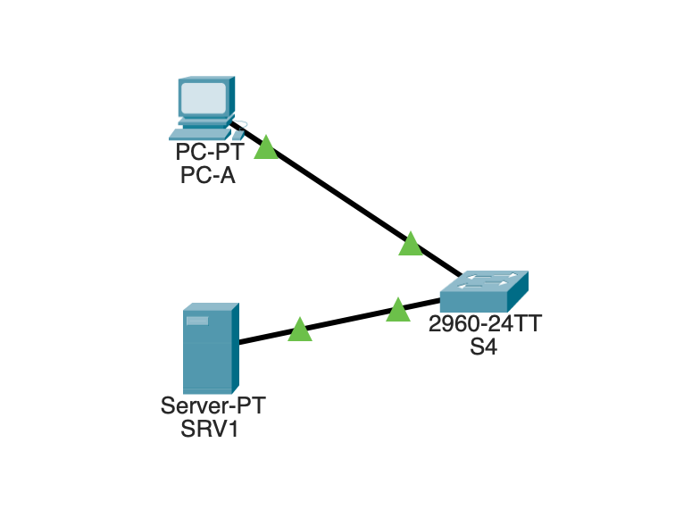
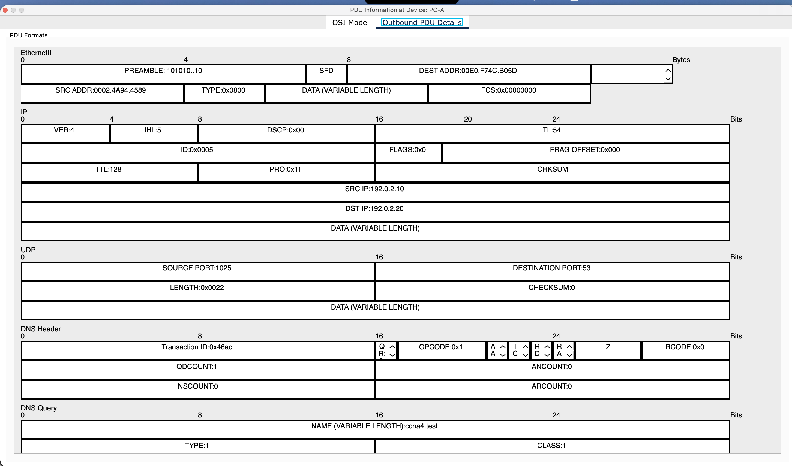
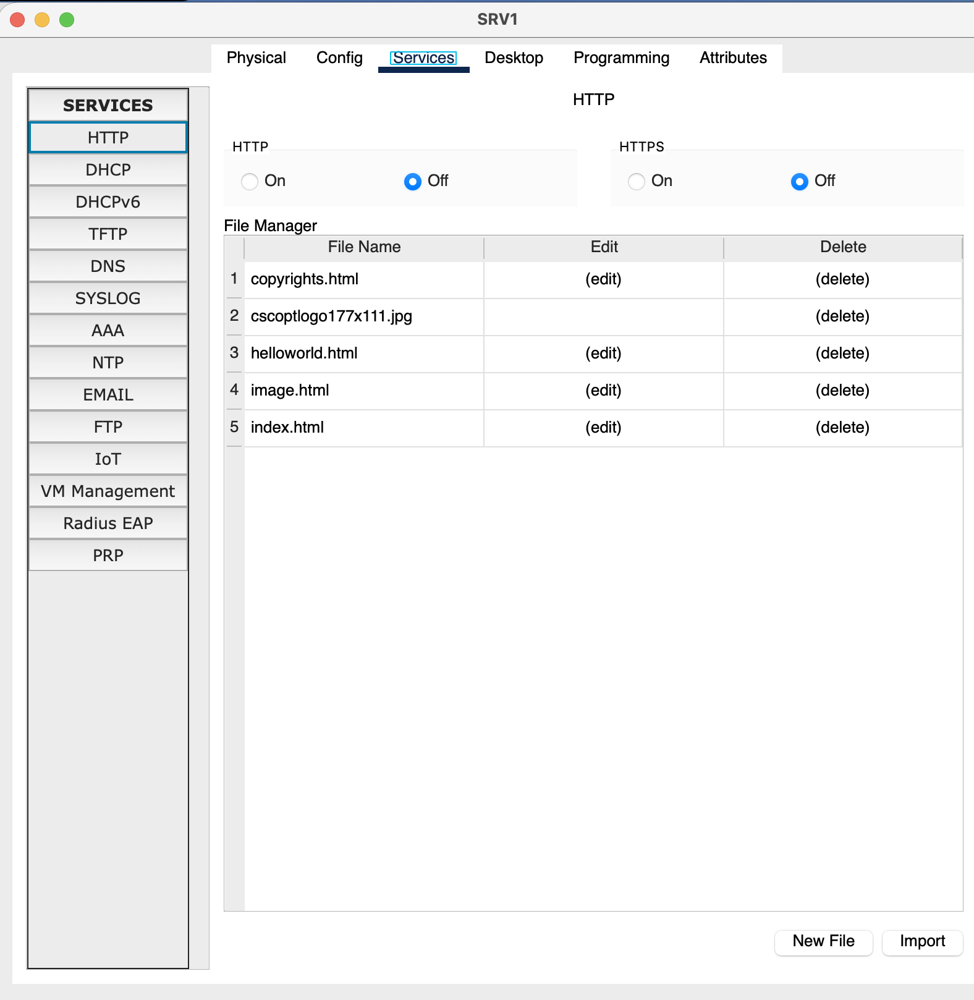
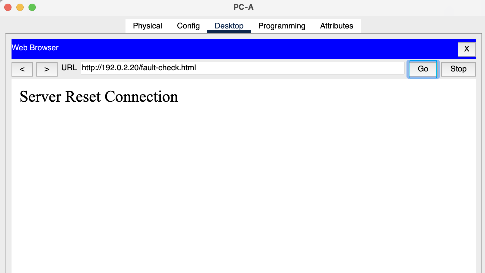
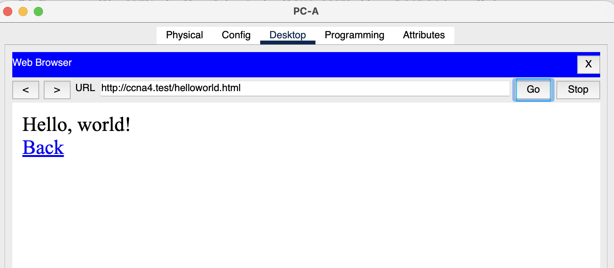

# L04 · DNS, TCP and an HTTP service failure

**Practical work:** verified from learner baseline, protocol, fault and recovery captures dated 27 October 2026.

## Scenario

PC-A (192.0.2.10/24) and SRV1 (192.0.2.20/24) connect to S4 in VLAN 1. PC-A uses SRV1 for DNS. SRV1 provides HTTP and an A record `ccna4.test → 192.0.2.20`. Both endpoints are on-link; a default gateway is unnecessary here.



*Local client/server lab with separate DNS and HTTP services.*

## Protocol observations

| Observed packet | Source → destination | Transport/ports | Meaning |
|---|---|---|---|
| DNS query for ccna4.test | PC-A → SRV1 | UDP 1025 → 53 | Resolve the server name |
| Server SYN-ACK | SRV1 → PC-A | TCP 80 → 1025 | Observed server handshake response |

The DNS query used IPv4 protocol 0x11 (UDP); the server reply used 0x06 (TCP). TCP flags 0x12 mean SYN+ACK. A numerically identical client port in TCP and UDP does not make them one flow.



*Actual DNS query and UDP header captured at PC-A.*

## Fault and diagnosis

**Changed item:** only SRV1's HTTP service was set to Off under Services → HTTP. PC-A's repeated ping to 192.0.2.20 still returned 4/4 replies. A fresh direct-IP HTTP request showed **Server Reset Connection**.

This isolates a service-level problem: an ICMP reply confirms that test's IP reachability, while a browser requires an available HTTP service. Using the server's IP also avoids depending on DNS for this fault test.



*Injected fault: HTTP Off on SRV1.*



*Fresh HTTP request fails while the separate ping control still works.*

## Solution and validation

Turn HTTP back On. Request a fresh page by IP and then by name. Repeat ping, `arp -a`, `show interfaces status` and `show mac address-table dynamic` as applicable.

```text
ping 192.0.2.20
arp -a
```



*Recovery: a fresh named HTTP request loads Hello, world!*

Direct-IP HTTP and named HTTP both recovered. Final ARP and S4 MAC entries matched the topology. No switch reconfiguration was needed to repair the service toggle.

**Evidence limits:** only the server SYN-ACK header was explicitly inspected, not all three handshake headers. The browser reset text was seen, but no TCP RST header was captured. Re-enabling HTTP is functionally supported by fresh successful requests; an additional HTTP On radio-button capture was not supplied.

Projects: [L04-baseline.pkt](../packet-tracer/L04-baseline.pkt) · [L04-http-off.pkt](../packet-tracer/L04-http-off.pkt) · [L04-recovered.pkt](../packet-tracer/L04-recovered.pkt) · [Command reference](../docs/COMMANDS.md) · [Index](../README.md)
