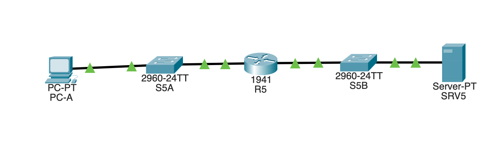
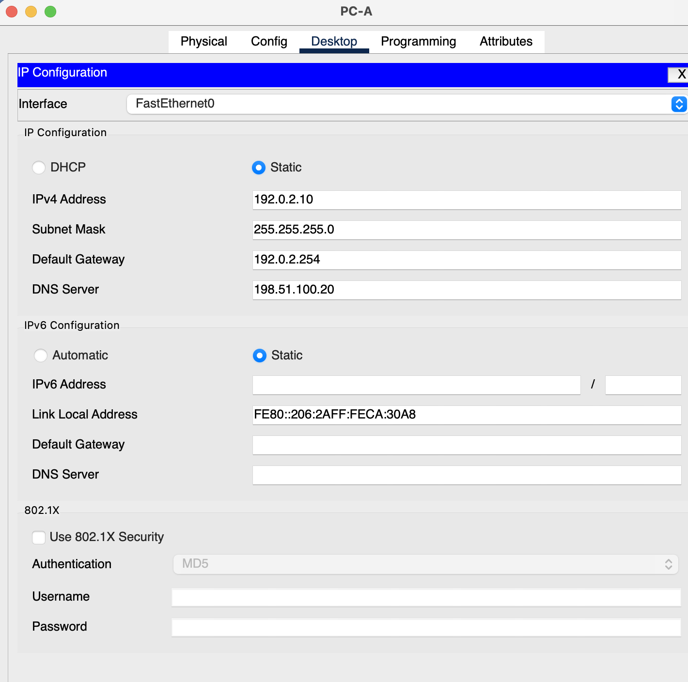
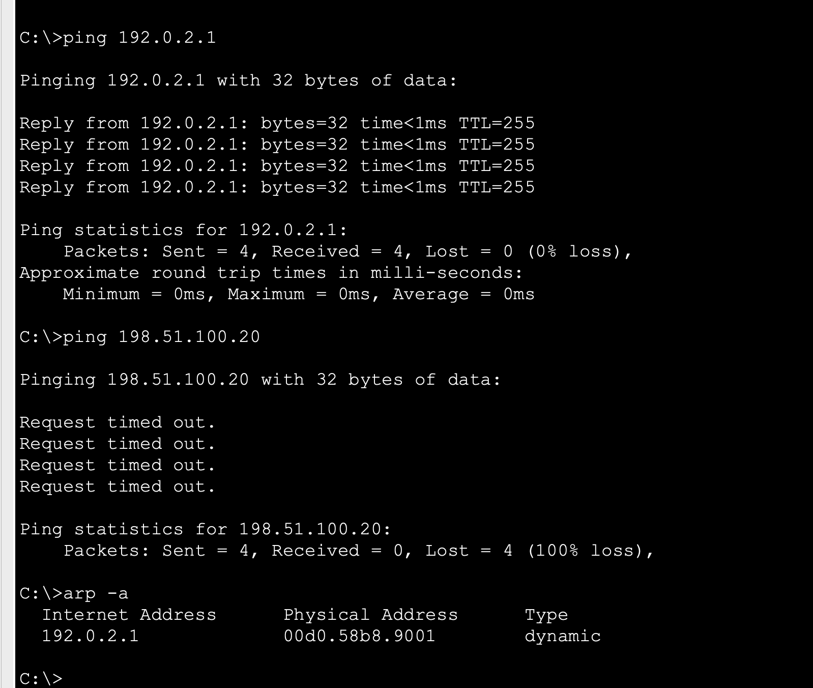
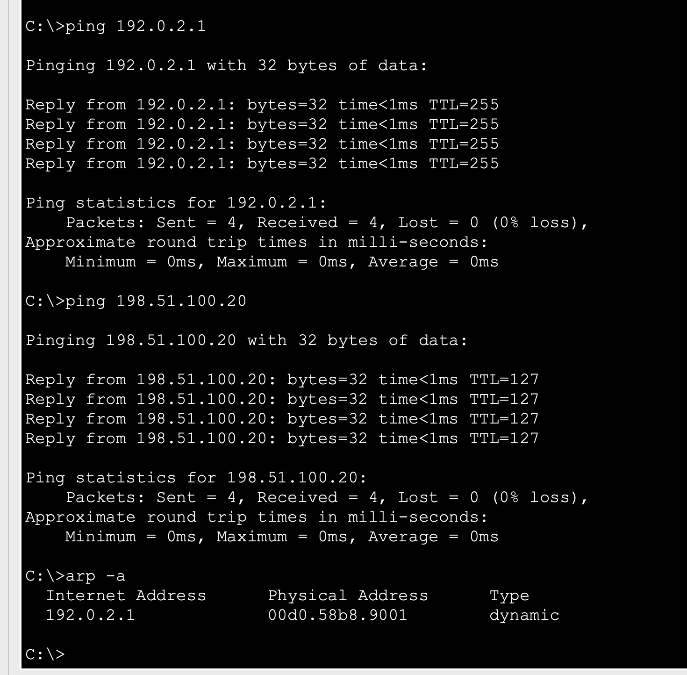
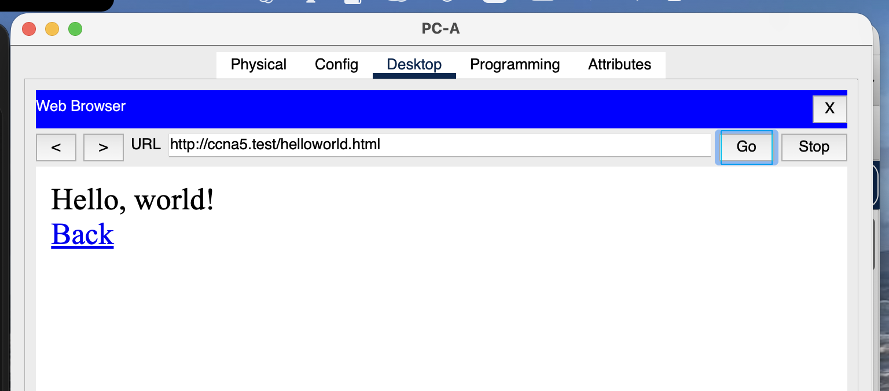

# L05 · Wrong client default gateway

**Practical work:** baseline, fault and recovery reviewed on 31 October 2026; the next-hop explanation was resolved with guided review.

## Scenario and addressing

PC-A reaches a web/DNS server on a different subnet through R5, with one access switch on each side.



*Two subnets routed by R5; each access switch serves a separate LAN.*

| Device/interface | Address | Gateway / DNS |
|---|---|---|
| PC-A | 192.0.2.10/24 | GW 192.0.2.1; DNS 198.51.100.20 |
| R5 Gi0/0 | 192.0.2.1/24 | LAN A |
| R5 Gi0/1 | 198.51.100.1/24 | LAN B |
| SRV5 | 198.51.100.20/24 | GW 198.51.100.1 |

R5 has both networks directly connected. Static routes, NAT and a dynamic routing protocol are unnecessary for this topology. SRV5 provides `ccna5.test` and HTTP.

## Fault and isolation

Only PC-A's gateway changed from **192.0.2.1 to unused 192.0.2.254**. IP address, mask and DNS remained the same.

| PC-A test during fault | Observed result | Diagnostic value |
|---|---|---|
| Ping 192.0.2.1 | 4/4 replies | Local/on-link delivery still works |
| Ping 198.51.100.20 | 0/4 replies | Remote delivery fails |
| Direct-IP HTTP to SRV5 | Request Timeout | Failure persists without a name lookup |



*Fault setting: the client gateway is .254.*



*Working local ping and failing remote ping during the gateway fault.*

The router's address remains reachable as a local destination even when the client is configured to use a different next hop for remote traffic. A cached ARP mapping for .1 does not override the wrong gateway selection.

## Solution

Restore **PC-A Desktop → IP Configuration → Default Gateway: 192.0.2.1**. Keep the other fields unchanged. Verify client parameters and compare local and remote tests:

```text
ipconfig /all
ping 192.0.2.1
ping 198.51.100.20
arp -a
```

Use `ipconfig` and the IP Configuration screen if a simulator option is unavailable. For a remote packet, the first Ethernet destination is R5's LAN-A MAC, while the IP destination remains SRV5. SRV5 also needs its own valid gateway to return traffic to PC-A's subnet.

## Recovery

Both pings returned 4/4 replies after repair. Direct-IP and named `/helloworld.html` requests loaded successfully. The observed PC ARP mapping was `192.0.2.1 → 00d0.58b8.9001`.



*Recovery: local and remote tests succeed, with the local next-hop ARP entry.*



*Named HTTP succeeds after restoring the gateway.*

**Limits:** an ARP request to .254 was not packet-captured. Some prompt titles are cropped and are attributed from adjacent labeled captures. Named HTTP functionally recovered; no separate recovery DNS packet was captured. This exercise ran in Packet Tracer, not on the host's real OS network stack.

Projects: [L05-baseline.pkt](../packet-tracer/L05-baseline.pkt) · [L05-recovered.pkt](../packet-tracer/L05-recovered.pkt) · [L05-wrong-gateway.pkt](../packet-tracer/L05-wrong-gateway.pkt) · [Command reference](../docs/COMMANDS.md) · [Index](../README.md)
