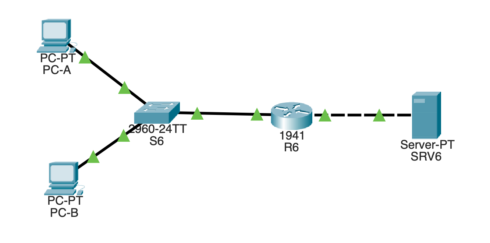
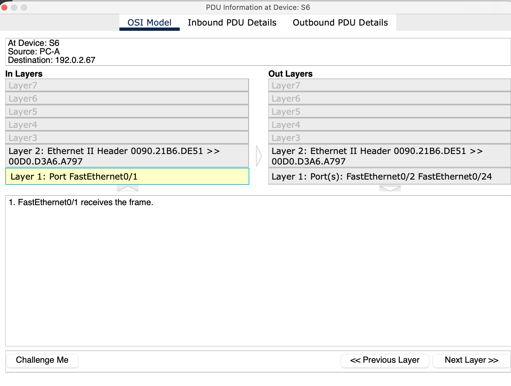
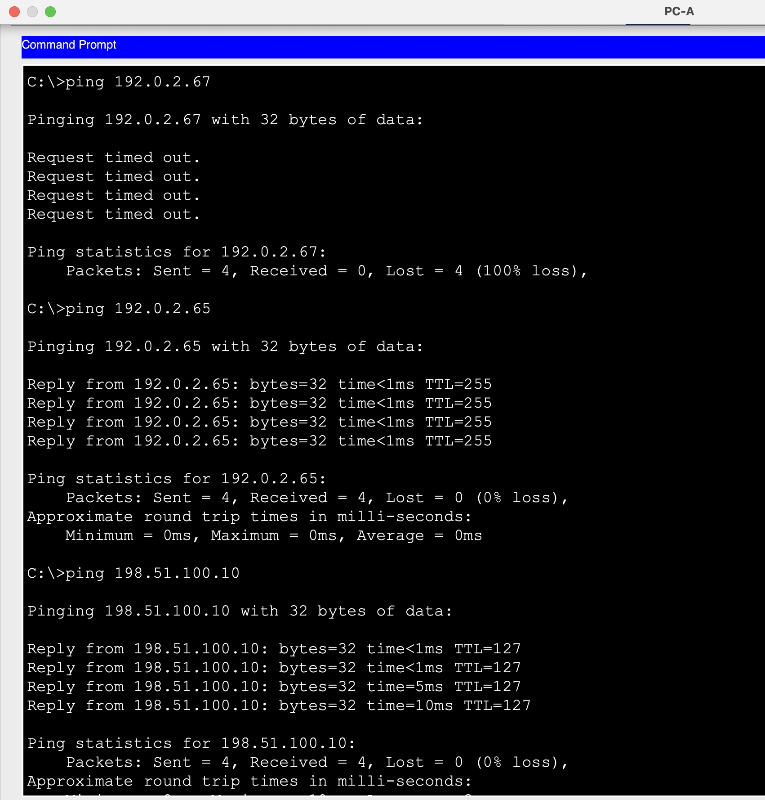
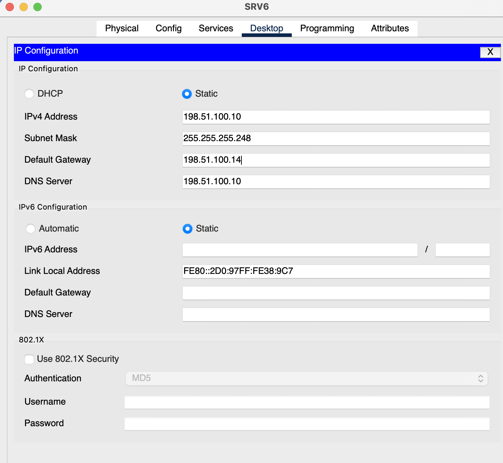
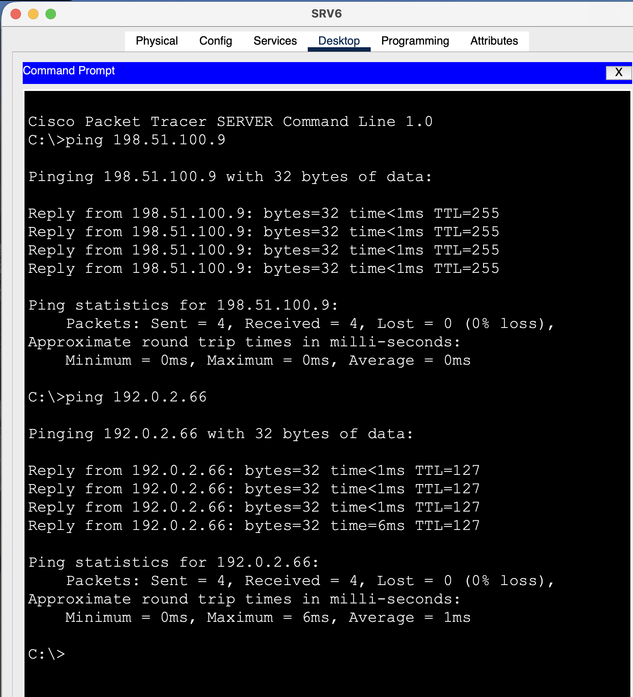
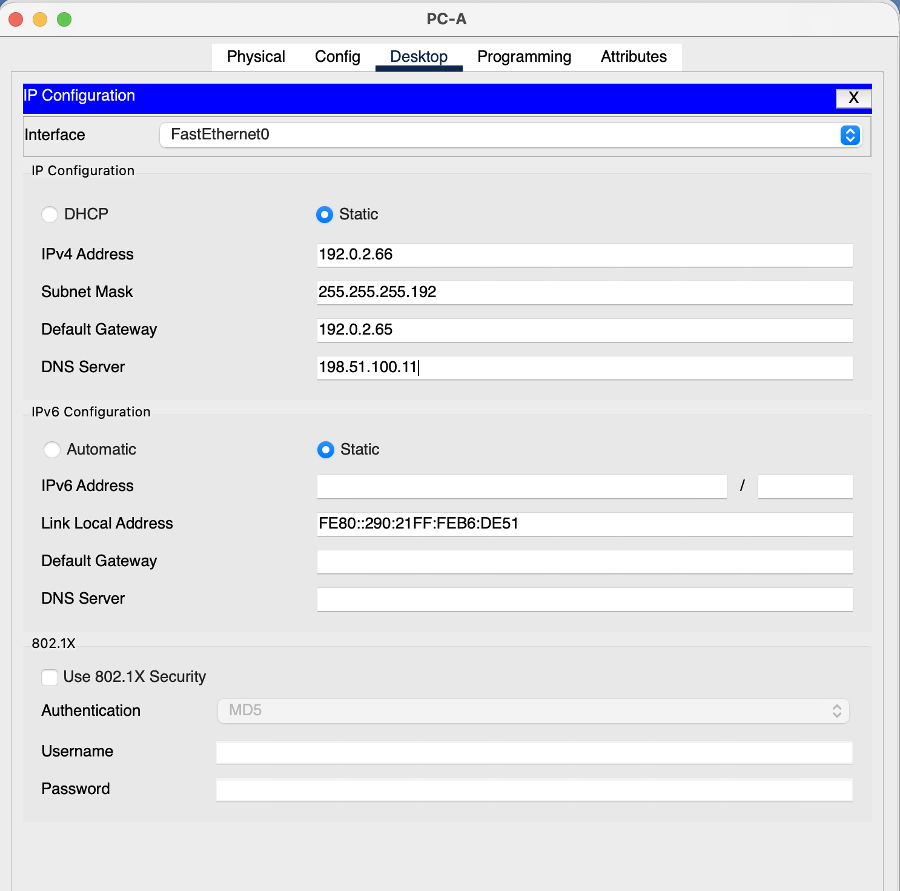
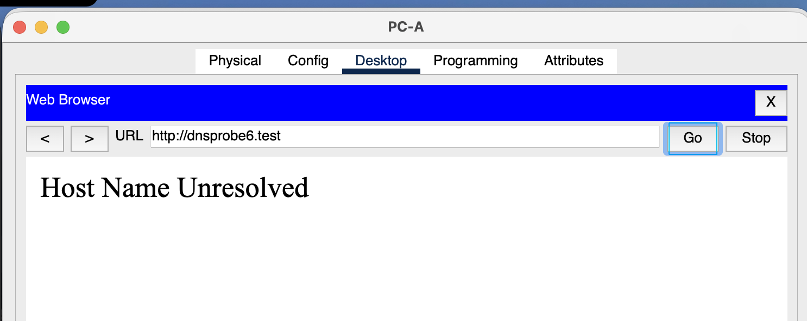
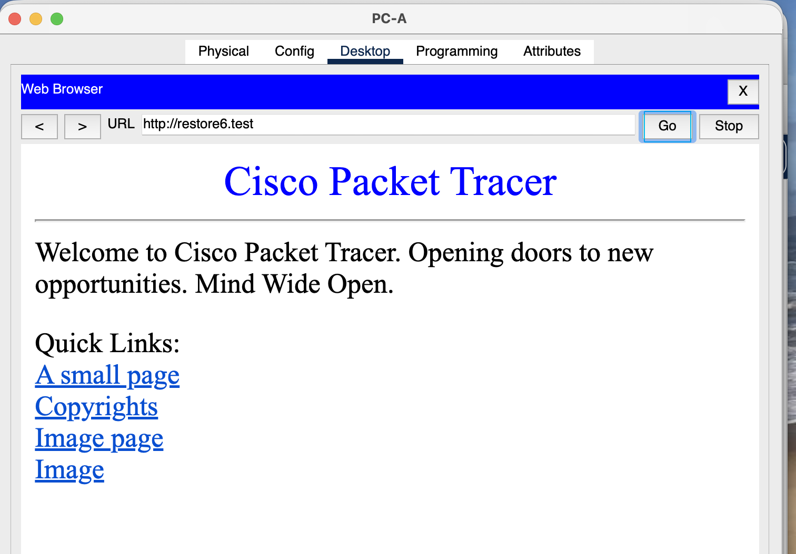

# L06 · Cable, return gateway and DNS faults

**Operational practical:** verified from learner captures dated 3–5 November 2026. The final gateway/DNS concepts were resolved with guided review on 5 November. Each fault starts from the same working baseline and changes one item.

## Topology and addressing



*The original routed LAN used for the three controlled faults.*

| Device/interface | Address / mask | Gateway | DNS |
|---|---|---|---|
| PC-A, S6 Fa0/1 | 192.0.2.66/26 | 192.0.2.65 | 198.51.100.10 |
| PC-B, S6 Fa0/2 | 192.0.2.67/26 | 192.0.2.65 | 198.51.100.10 |
| R6 Gi0/0, S6 Fa0/24 | 192.0.2.65/26 | — | — |
| R6 Gi0/1 | 198.51.100.9/29 | — | — |
| SRV6 | 198.51.100.10/29 | 198.51.100.9 | 198.51.100.10 |

The masks are 255.255.255.192 and 255.255.255.248. DNS records `ccna6.test`, `dnsprobe6.test` and `restore6.test` point to SRV6; the latter names were reserved for later tests. R6 needs its two connected routes, not NAT or an extra routing protocol.

## Controlled unknown-unicast observation

PC-A's ARP entry for PC-B was kept warm. Clearing S6's dynamic MAC table removed the switch's destination learning without clearing the PC cache:

```text
enable
clear mac address-table dynamic
show mac address-table dynamic
```

At the first relevant S6 request, the frame entered **Fa0/1** and copies left **Fa0/2 and Fa0/24**. Its source stayed `0090.21b6.de51` and its destination stayed PC-B's unicast MAC `00d0.d3a6.a797`. S6 learned PC-A from the source; the reply subsequently supplied PC-B's source/port association.



*Observed first unknown-unicast request: two eligible egress ports, excluding ingress.*

This later observation resolves the missing flooding evidence from L03 without relabeling L03's known-unicast capture.

## Fault 1 · Disconnected PC-B cable

**Change:** remove only PC-B FastEthernet0 ↔ S6 Fa0/2. **Symptom:** PC-A → PC-B returned 0/4; PC-A → R6 and PC-A → SRV6 each returned 4/4. S6 Fa0/2 showed not connected.

**Reasoning:** the failing branch is specific to PC-B; the working routed-server test helps rule out a shared router/server path failure.

**Repair:** reconnect the original ports using the intended copper straight-through cable. Inspect `show interfaces status`, wait for forwarding, and repeat all three pings plus a fresh HTTP request.



*F1: PC-B fails while the router and server controls pass.*

**Recovery:** S6 Fa0/2 was connected, all three PC-A paths returned 4/4, and a fresh HTTP page was captured after repair. An already displayed browser page during the fault was not used as proof of a new successful request.

## Fault 2 · Wrong server return gateway

**Change:** SRV6 gateway **198.51.100.9 → unused 198.51.100.14**. **Observed:** SRV6 could ping its local router .9 (4/4), PC-A could ping its own gateway (4/4), but PC-A → SRV6 failed (0/4) and direct-IP HTTP timed out.



*F2: wrong gateway .14 on the server, with the other IPv4 fields retained.*

A server must select a valid local next hop for replies to a remote client. The packet's remote IP destination does not change to the gateway; the link-layer destination on that outgoing segment is the selected gateway's MAC. The results fit a broken return path. No arriving request/reply ARP packet capture is claimed here.

**Repair:** restore only SRV6 gateway to **198.51.100.9**. **Recovery:** PC-A → server and server → PC-A returned 4/4; direct-IP and `ccna6.test` HTTP requests succeeded.



*F2 recovery: the server reaches its local router and the remote client.*

## Fault 3 · Wrong client DNS server

**Change:** PC-A DNS **198.51.100.10 → unused 198.51.100.11**. **Observed:** server IP ping remained 4/4 and direct-IP HTTP worked, while the reserved `dnsprobe6.test` request displayed **Host Name Unresolved**.



*F3: only PC-A DNS changes to .11.*



*F3: fresh reserved-name request fails while IP controls work.*

**Repair:** restore only PC-A DNS to **198.51.100.10**. Test the other reserved name `restore6.test`, then repeat the IP ping and HTTP controls. Name-based access recovered and the final IP checks succeeded.



*F3 recovery: restore6.test resolves and the HTTP page loads.*

DNS maps a name to an address; it does not translate source/destination IP addresses as NAT does. A previously cached name is an unreliable test of a newly changed resolver, which is why separate reserved names were used.

## Command and rollback notes

`show ip interface brief` checks R6 addressing and up/up state. `show ip route` checks the actual connected/local routes. `show interfaces status` checks S6 links; `show mac address-table dynamic` and client `arp -a` inspect different mappings. Use `end` before privileged EXEC commands if currently in interface configuration.

Preserve baseline, MAC-observation and all F1/F2/F3 fault/recovered `.pkt` files separately. Roll back the single changed item or reopen the untouched baseline. Initial ping loss followed by a successful repeat was recorded; it was not rewritten as a perfect first result.

**Limits:** operational recovery is evidenced by screenshots. Detailed DNS record-table contents, DNS headers, absolute cache state and the internal saved-file timing were not independently inspected. Guided completion does not imply unseen independent mastery.

Projects: [L06-F1-recovered.pkt](../packet-tracer/L06-F1-recovered.pkt) · [L06-F2-return-gateway-fault.pkt](../packet-tracer/L06-F2-return-gateway-fault.pkt) · [L06-F3-DNS-fault.pkt](../packet-tracer/L06-F3-DNS-fault.pkt) · [L06-MAC-observation.pkt](../packet-tracer/L06-MAC-observation.pkt) · [L06-F2-recovered.pkt](../packet-tracer/L06-F2-recovered.pkt) · [L06-F1-cable-fault.pkt](../packet-tracer/L06-F1-cable-fault.pkt) · [L06-F3-recovered.pkt](../packet-tracer/L06-F3-recovered.pkt) · [L06-baseline.pkt](../packet-tracer/L06-baseline.pkt) · [Command reference](../docs/COMMANDS.md) · [Index](../README.md)
