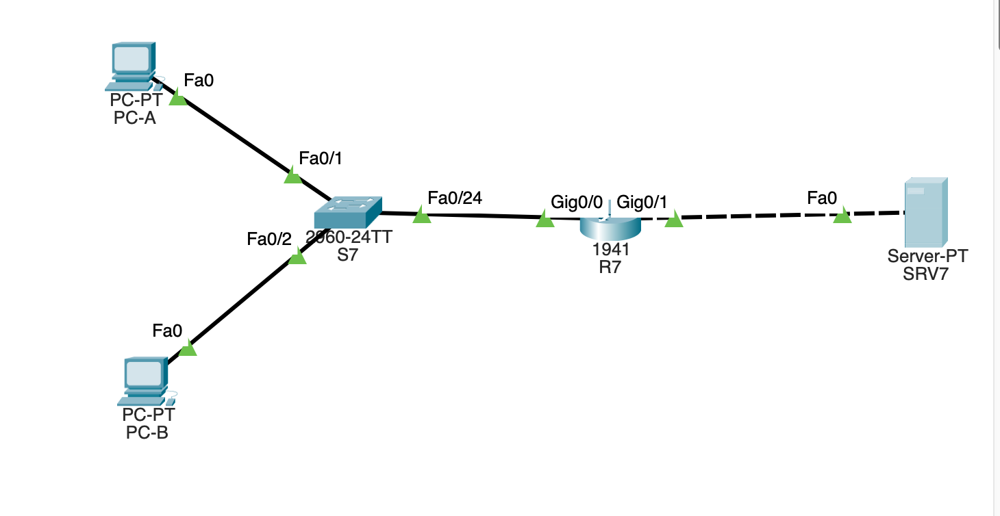
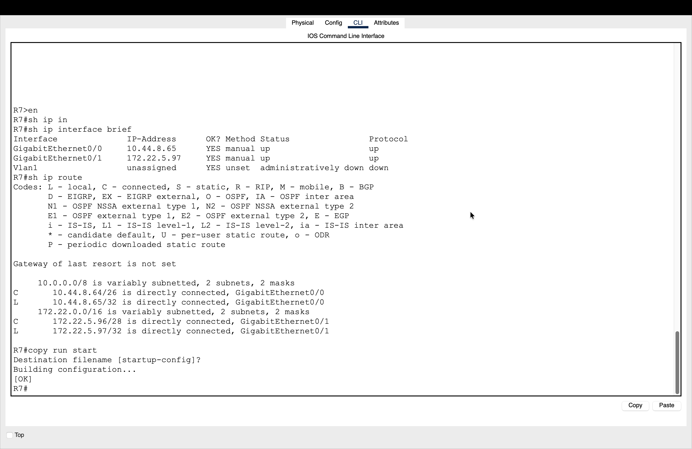
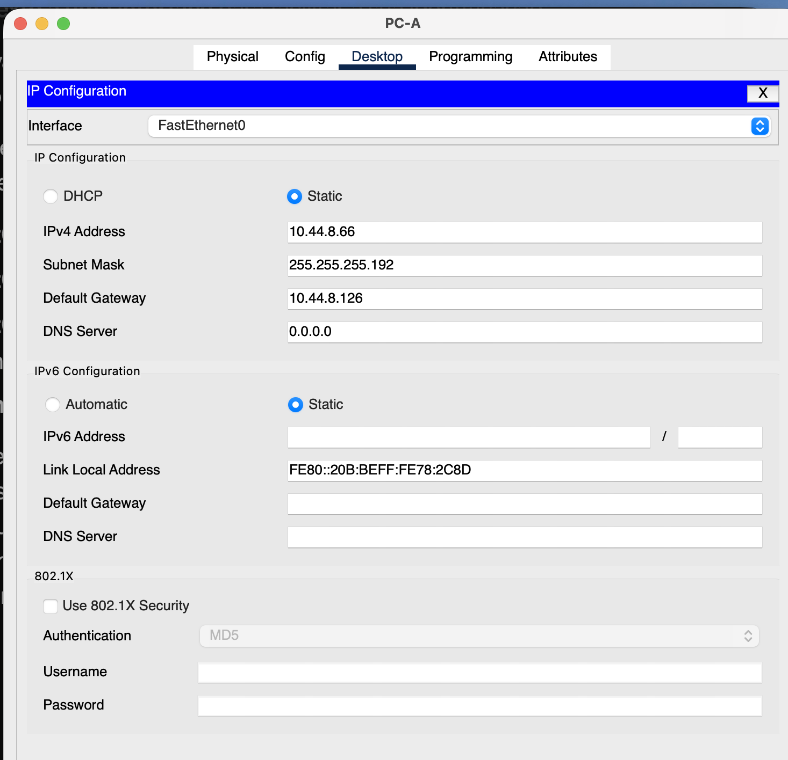
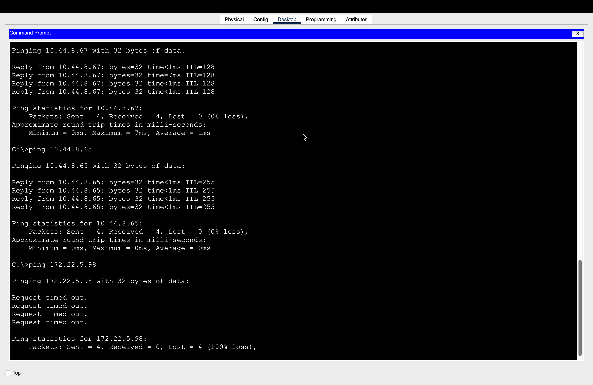
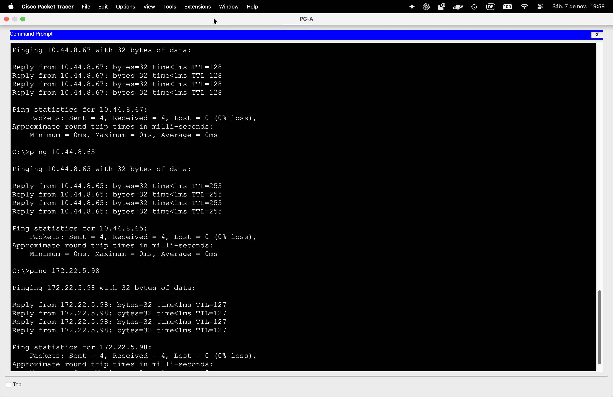
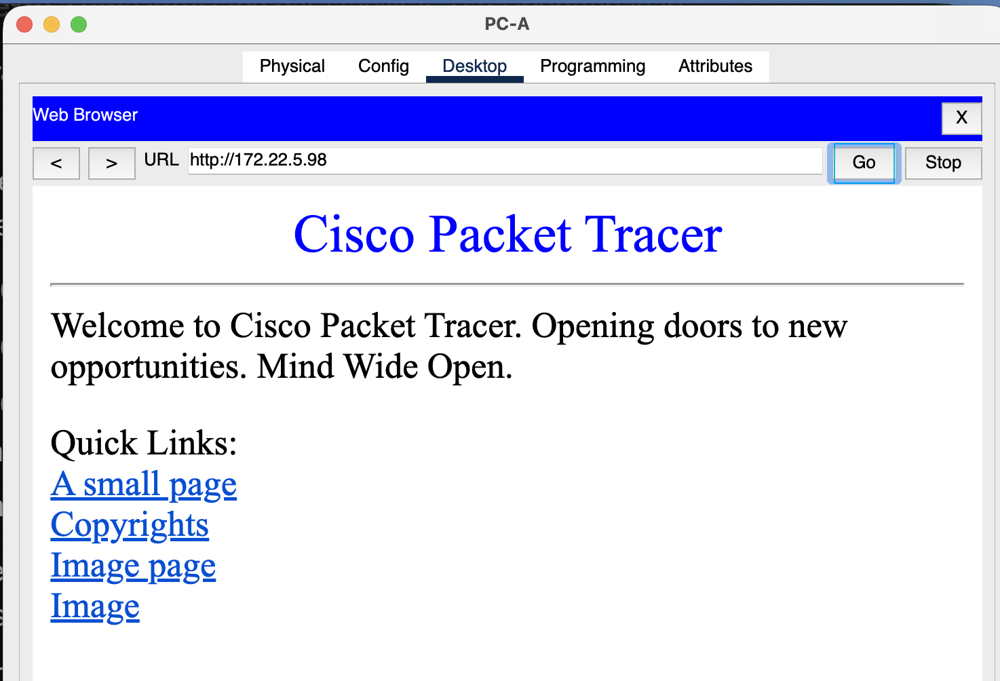

# L07 · IPv4 subnets and a wrong client gateway

**Practical completion:** 7 November 2026, after guided review of baseline, controlled fault and recovery evidence. This case connects subnet calculations to a client's local-versus-remote forwarding decision. Configuration examples explain reproduction; they are not a new execution transcript from publication.

## Topology and address plan



PC-A Fa0 connects to S7 Fa0/1, PC-B Fa0 to S7 Fa0/2, and S7 Fa0/24 to R7 Gi0/0. R7 Gi0/1 connects directly to SRV7 Fa0. The switch stays in VLAN 1. Use straight-through cables for the switch links and crossover or supported automatic cable selection for the router-to-server link.

| Device / interface | IPv4 address | Mask | Default gateway |
|---|---|---|---|
| R7 Gi0/0 | 10.44.8.65 | 255.255.255.192 (/26) | — |
| PC-A | 10.44.8.66 | 255.255.255.192 (/26) | 10.44.8.65 |
| PC-B | 10.44.8.67 | 255.255.255.192 (/26) | 10.44.8.65 |
| R7 Gi0/1 | 172.22.5.97 | 255.255.255.240 (/28) | — |
| SRV7 | 172.22.5.98 | 255.255.255.240 (/28) | 172.22.5.97 |

| LAN | Network | Usable range | Broadcast | Usable capacity |
|---|---|---|---|---|
| Clients | 10.44.8.64/26 | 10.44.8.65–10.44.8.126 | 10.44.8.127 | 62 |
| Server | 172.22.5.96/28 | 172.22.5.97–172.22.5.110 | 172.22.5.111 | 14 |

Both networks use private IPv4 space. The subnet mask, rather than the private-range boundary, determines which destinations each endpoint treats as local. No DNS, NAT or dynamic routing is needed. SRV7's HTTP service is enabled and tested by literal IP address.

## Configure and verify the baseline

Starting from R7 privileged EXEC:

```text
configure terminal
hostname R7
interface GigabitEthernet0/0
 description L07-client-LAN
 ip address 10.44.8.65 255.255.255.192
 no shutdown
exit
interface GigabitEthernet0/1
 description L07-SRV7
 ip address 172.22.5.97 255.255.255.240
 no shutdown
end
show ip interface brief
show ip route
copy running-config startup-config
```

Set S7's hostname and port descriptions to match the topology. Configure the endpoints under Desktop → IP Configuration, then compare the local peer, local router and remote server. Save the switch configuration and the Packet Tracer project separately.



The reviewed table contains connected routes `10.44.8.64/26` through Gi0/0 and `172.22.5.96/28` through Gi0/1, plus local /32 routes for the router addresses. A default route is unnecessary for communication between these directly connected networks.

| Check | Purpose | Interpretation / pitfall |
|---|---|---|
| R7 `show ip interface brief` | Inspect addresses and interface state | Correct addressing with a down link is insufficient |
| R7 `show ip route` | Check connected subnet prefixes and local addresses | `C` describes a connected network; `L` identifies the router's own address |
| S7 `show interfaces status` | Confirm the three intended switch links | Check the actual ports, not just a green topology icon |
| PC-A `arp -a` | Inspect local IPv4-to-MAC mappings | Remote SRV7 traffic uses the local router's MAC, not SRV7's MAC |
| S7 `show mac address-table dynamic` | Compare learned MAC addresses and ports | A switch MAC table and a PC ARP table answer different questions |
| PC `ping <address>` | Compare local and routed ICMP exchanges | A reply requires working delivery in both directions |
| PC browser `http://172.22.5.98` | Check the actual HTTP service | Successful ping alone does not establish application availability |
| `copy running-config startup-config` | Preserve IOS configuration | This does not save the `.pkt` project |

The accepted baseline includes six successful ping checks across the peer, local-router and routed-server paths, plus a loaded HTTP page. The first PC-A-to-server attempt had one timeout; its repeat returned 4/4. Address resolution is a plausible explanation, but no packet capture establishes the cause of that initial loss.

## Fault: a usable address is not necessarily a gateway

Change **only PC-A's default gateway from `10.44.8.65` to unused `10.44.8.126`**. Retain its address, mask, cables and the rest of the topology.



| Source | Destination | Fault result | After restoring the gateway |
|---|---|---|---|
| PC-A | PC-B 10.44.8.67 | 4/4 replies | 4/4 replies |
| PC-A | Local R7 10.44.8.65 | 4/4 replies | 4/4 replies |
| PC-A | Remote SRV7 172.22.5.98 | 0/4 replies | 4/4 replies |



The source device title is cropped from this fault-results capture; PC-A attribution comes from the reviewed sequence and companion settings capture. The destination addresses and results are visible.

PC-A can deliver to PC-B and R7's client-facing address directly within `10.44.8.64/26`. Reaching the router's own local IP does not require using the configured default gateway. SRV7 is outside that /26, so PC-A needs a working router next hop. Address `.126` is a valid host address in the client subnet, but no router owns it in this lab. This controlled change explains the failure without changing R7's routes or the server.

## Repair, recovery and rollback

Restore **only PC-A's gateway to `10.44.8.65`**. Repeat all three tests from the table and request the HTTP page again.





These checks establish restored local and remote operation for the tested flows. If a working copy accumulates unrelated changes, preserve the failed attempt and reopen a separate baseline copy before reproducing the one-setting fault.

## Saved projects and evidence scope

| Intended state | Download |
|---|---|
| Baseline | [L07-baseline.pkt](../packet-tracer/L07-baseline.pkt) |
| Wrong PC-A gateway | [L07-fault.pkt](../packet-tracer/L07-fault.pkt) |
| Recovery | [L07-recovered.pkt](../packet-tracer/L07-recovered.pkt) |

These are the available learner-saved files, preserved byte-for-byte at publication and fingerprinted in the asset manifest. Their internal configuration and original save timing were not independently inspected. The available recovery file differs from the fingerprint recorded during the original completion review; the manifest identifies the bytes actually published. Check the actual state after opening a separate working copy. No fresh simulator rerun is claimed.

**Takeaway:** a successful local-router ping does not validate the client's default gateway. Compare an on-subnet control with an off-subnet destination, repair the selected next hop, and retest the application.

[Related client-gateway case](L05-client-gateway.md) · [VLSM and the server return path](L08-vlsm-return-gateway.md) · [Command reference](../docs/COMMANDS.md) · [Evidence scope](../docs/EVIDENCE_POLICY.md) · [Index](../README.md)
