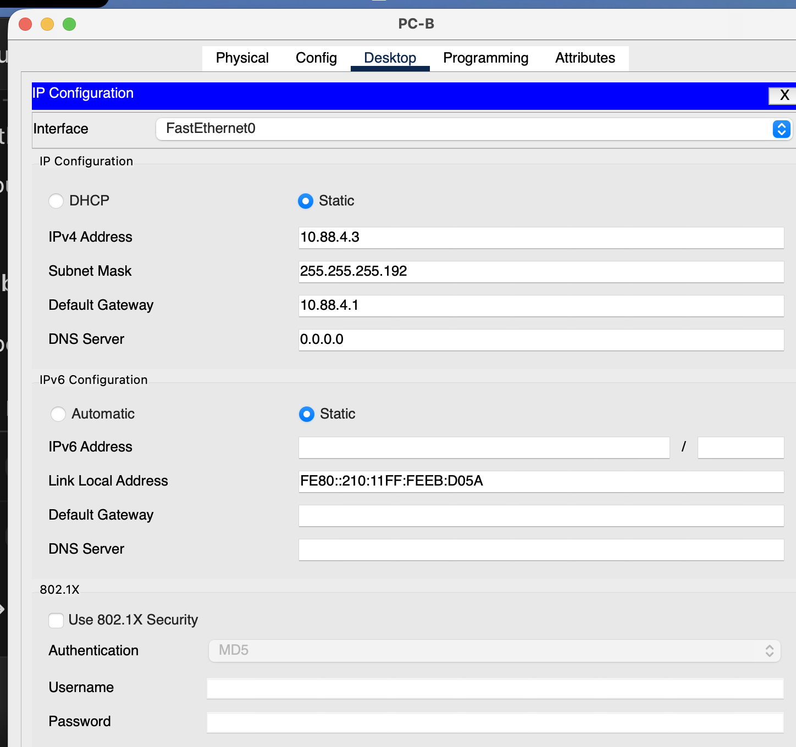
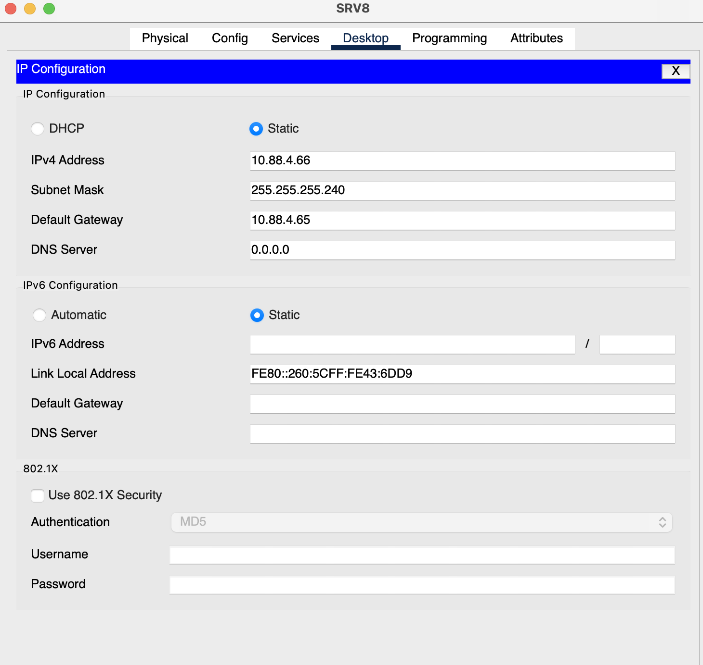
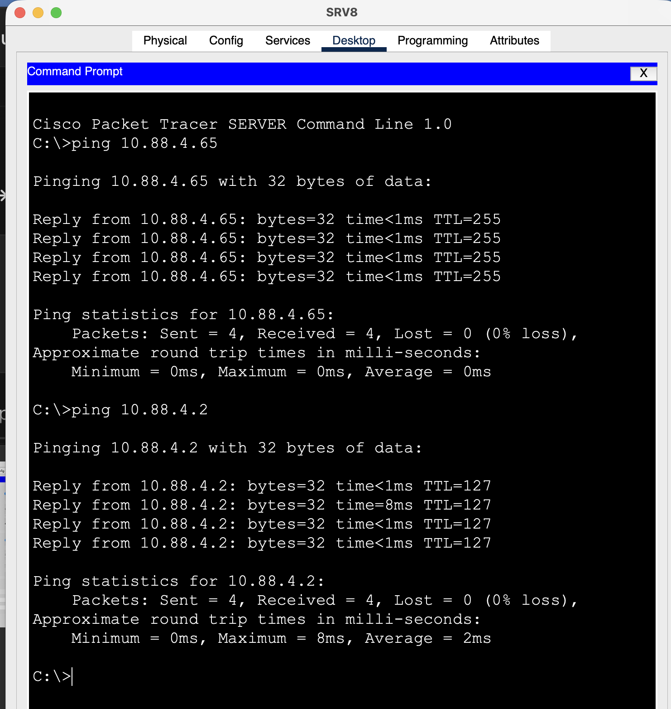

# L08 · VLSM planning and a broken server return path

**Practical completion:** 10 November 2026, after guided planning and reviewed baseline, fault and recovery evidence. The case allocates different subnet sizes from one /24, then isolates a server gateway fault. Commands below are reproduction instructions, not a fresh execution transcript.

## Plan the subnets before configuring devices

Parent block: **10.88.4.0/24**. The requirements are 45 office addresses, 12 server-LAN addresses and 6 future-LAN addresses, with each count already including its gateway. Allocate the largest subnet first from the lowest available aligned boundary.

| Purpose | Required hosts | Prefix / mask | Network | Usable range | Broadcast | Usable capacity |
|---|---|---|---|---|---|---|
| Office | 45 | /26 · 255.255.255.192 | 10.88.4.0 | 10.88.4.1–10.88.4.62 | 10.88.4.63 | 62 |
| Server | 12 | /28 · 255.255.255.240 | 10.88.4.64 | 10.88.4.65–10.88.4.78 | 10.88.4.79 | 14 |
| Future | 6 | /29 · 255.255.255.248 | 10.88.4.80 | 10.88.4.81–10.88.4.86 | 10.88.4.87 | 6 |

For these ordinary IPv4 LAN subnets, usable capacity is `2^(32-prefix) - 2`. A /27 has only 30 usable addresses and cannot meet the office requirement. A /29 has six and cannot meet the server requirement. The chosen blocks are aligned, contained in the /24 and do not overlap. Addresses `.88` onward remain unallocated by this plan; they are not all one aligned subnet.

The future LAN is **planned only**. No extra router interface, connected route or future-LAN execution is claimed.

## Topology and applied addressing

```text
PC-A Fa0 -- S8 Fa0/1
PC-B Fa0 -- S8 Fa0/2
S8 Fa0/24 -- R8 Gi0/0
R8 Gi0/1 -- SRV8 Fa0
```

Use straight-through cables for switch links and crossover or supported automatic cable selection for the direct router-to-server link. VLAN 1 is sufficient on S8. No switch management address, DNS, NAT or static route is required for these directly connected LANs.

| Device / interface | IPv4 address | Mask | Gateway |
|---|---|---|---|
| R8 Gi0/0 | 10.88.4.1 | 255.255.255.192 (/26) | — |
| PC-A | 10.88.4.2 | 255.255.255.192 (/26) | 10.88.4.1 |
| PC-B | 10.88.4.3 | 255.255.255.192 (/26) | 10.88.4.1 |
| R8 Gi0/1 | 10.88.4.65 | 255.255.255.240 (/28) | — |
| SRV8 | 10.88.4.66 | 255.255.255.240 (/28) | 10.88.4.65 |

## Baseline configuration and checks

Starting from R8 privileged EXEC:

```text
configure terminal
hostname R8
interface GigabitEthernet0/0
 description L08-office
 ip address 10.88.4.1 255.255.255.192
 no shutdown
exit
interface GigabitEthernet0/1
 description L08-server
 ip address 10.88.4.65 255.255.255.240
 no shutdown
end
show ip interface brief
show ip route
copy running-config startup-config
```

Configure S8's hostname, endpoint/uplink descriptions and intended ports. Configure the clients and server from the table, leave DNS unconfigured for these literal-IP tests, and enable HTTP on SRV8.





| Check | Purpose | Interpretation / pitfall |
|---|---|---|
| R8 `show ip interface brief` | Confirm both used interfaces are up/up | Administrative intent alone is insufficient |
| R8 `show ip route` | Inspect the applied VLSM prefixes | Expect connected `.0/26` and `.64/28`, plus local /32s; the future /29 is not connected |
| R8 `show running-config` | Compare configured address and mask on each interface | Do not infer masks just from an address summary |
| S8 `show interfaces status` | Check Fa0/1, Fa0/2 and Fa0/24 | Compare physical state and VLAN membership |
| PC-A `arp -a` | Inspect the office peer and local router mappings | The remote server's MAC is not the next-hop MAC on the office LAN |
| S8 `show mac address-table dynamic` | Relate MAC addresses to local switch ports | R8 separates the server's Layer 2 segment |
| PC/server `ping <IP>` | Compare local and remote paths from both ends | A server-to-router local test does not validate its remote return path |
| Browser `http://10.88.4.66/helloworld.html` | Test HTTP without adding DNS | Use a fresh request after each state change |



The baseline review also accepted PC-A-to-peer/router/server tests, the office ARP/MAC mappings, connected routes, HTTP and IOS startup saves. Its initial PC-A-to-server ping returned 3/4; a repeat returned 4/4. No packet-level cause was established for the initial single loss.

## Fault: change only the server's gateway

Save a separate fault project. On SRV8, change the default gateway **`10.88.4.65` → unused `10.88.4.78`**. Keep its `.66/28` address, PC settings, router settings and cables unchanged.

The following results come from the dated review of the learner's eight fault/recovery screenshots on **10 November 2026, 21:50–21:55 Europe/Berlin**. The original temporary image files for that sequence were unavailable at publication. The three original images embedded on this page are baseline captures from 9 November; they are not presented as fault/recovery screenshots.

| Source | Test | Fault result recorded in review | Recovery result recorded in review |
|---|---|---|---|
| SRV8 | Local R8 10.88.4.65 | 4/4 replies | 4/4 replies |
| SRV8 | Remote PC-A 10.88.4.2 | 0/4 replies | 4/4 replies |
| PC-A | Local R8 10.88.4.1 | 4/4 replies | 4/4 replies |
| PC-A | Remote SRV8 10.88.4.66 | 0/4 replies | 4/4 replies |
| PC-A | Fresh direct-IP HTTP URL above | Request Timeout | Hello, world! page loaded |

Address `.78` is a usable host address in the server /28, but no device owns it in this topology. SRV8 can still reach its local router directly. For PC-A on another subnet, SRV8 needs a valid gateway for outgoing traffic, including echo replies and HTTP responses. A correct request path from PC-A does not fix the server's return path. This explanation follows the controlled change and recovery; a capture proving each individual request arrived at SRV8 is not claimed.

## Solution, validation and rollback

Restore **only SRV8's gateway to `10.88.4.65`**. Repeat all four pings and the same fresh HTTP request. The completion review records 4/4 for every ping and a loaded HTTP page. Save `L08-recovered.pkt` separately from the baseline and fault files.

If reproducing the case, inspect the actual settings after opening the project. Undo the one changed gateway, or reopen a separate baseline copy if other changes have accumulated. Keep the failed copy for comparison. No host networking or real service changes are part of this simulator exercise.

## Saved projects and evidence scope

| Intended state | Download |
|---|---|
| Baseline | [L08-baseline.pkt](../packet-tracer/L08-baseline.pkt) |
| Wrong SRV8 gateway | [L08-fault.pkt](../packet-tracer/L08-fault.pkt) |
| Recovery | [L08-recovered.pkt](../packet-tracer/L08-recovered.pkt) |

The available learner-saved files are preserved and fingerprinted in the asset manifest. The duplicate baseline filename found locally was not uploaded a second time. Project internals and exact save timing were not independently inspected, and no new simulator rerun is claimed. Operational completion rests on the recorded evidence review, with the screenshot-availability limit stated above.

**Takeaway:** VLSM creates valid address blocks; it does not ensure endpoints use the right gateway. Verify capacity, boundaries and overlap, then test both directions and the application after repairing the return path.

[IPv4 client-gateway comparison](L07-ipv4-subnets.md) · [Earlier server return-gateway case](L06-layered-troubleshooting.md#fault-2--wrong-server-return-gateway) · [Command reference](../docs/COMMANDS.md) · [Evidence scope](../docs/EVIDENCE_POLICY.md) · [Index](../README.md)
