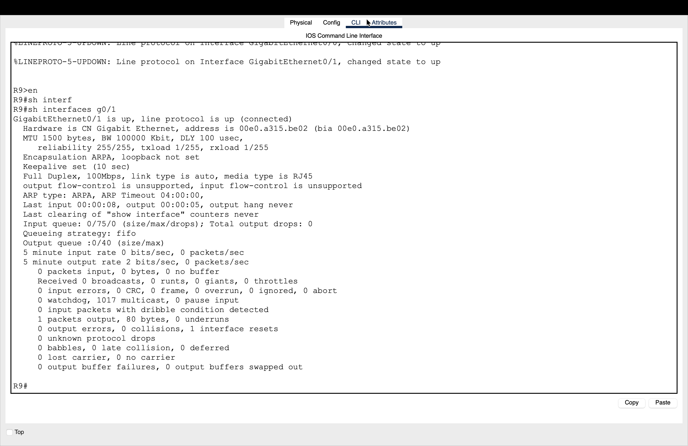
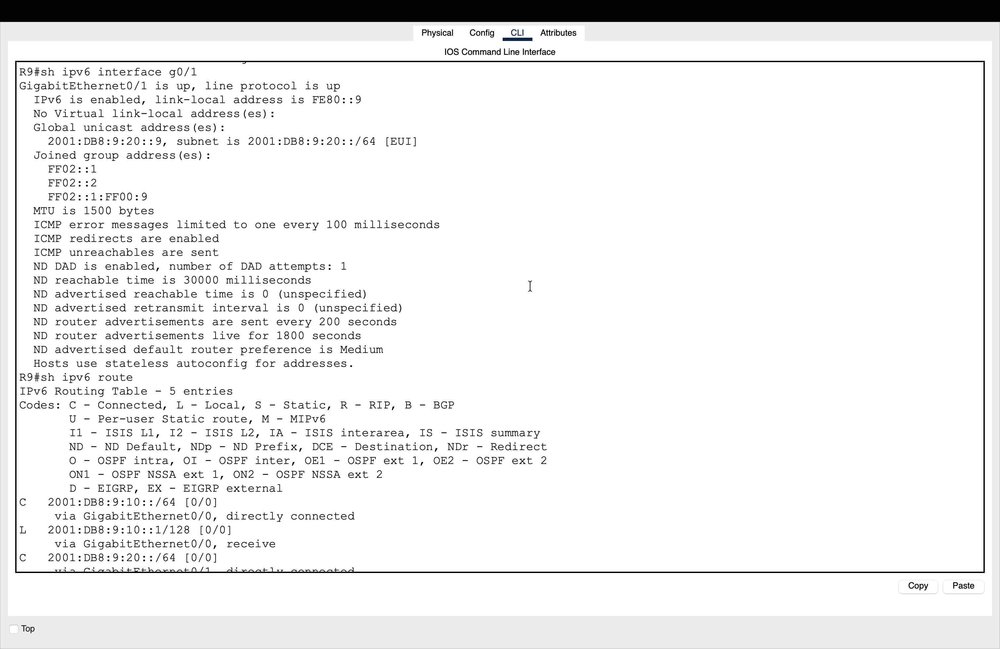
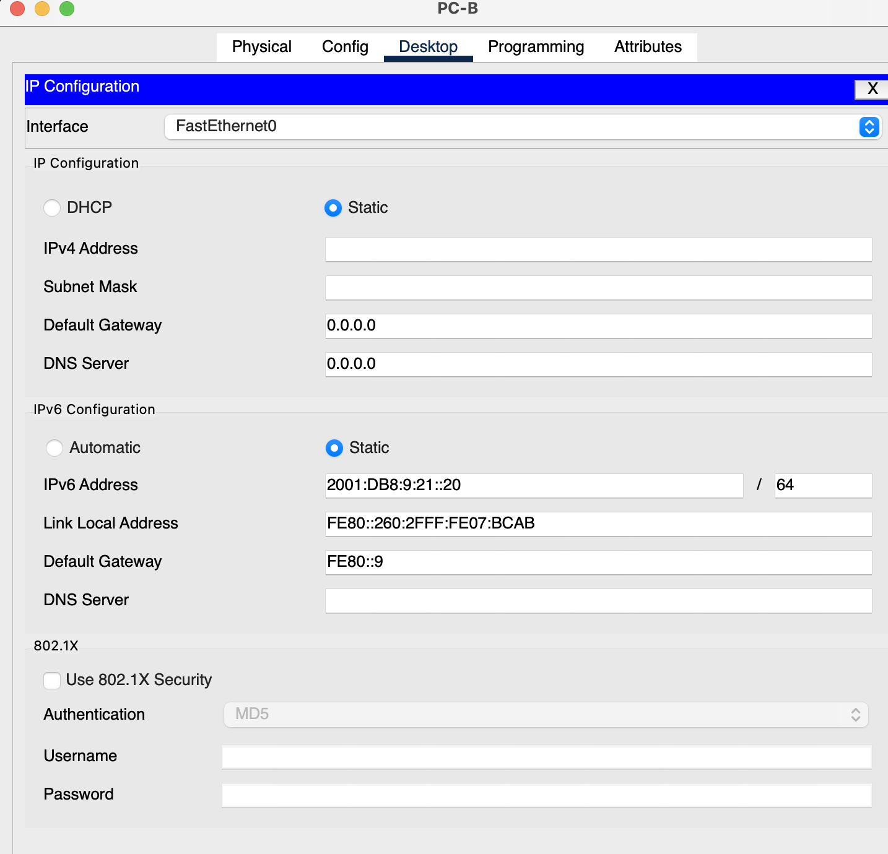
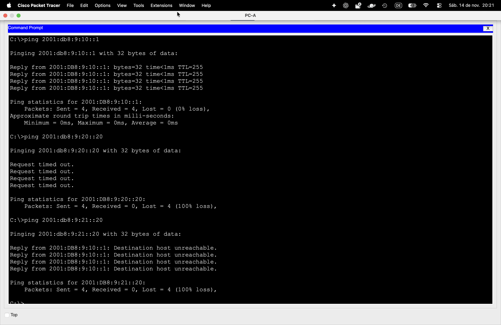
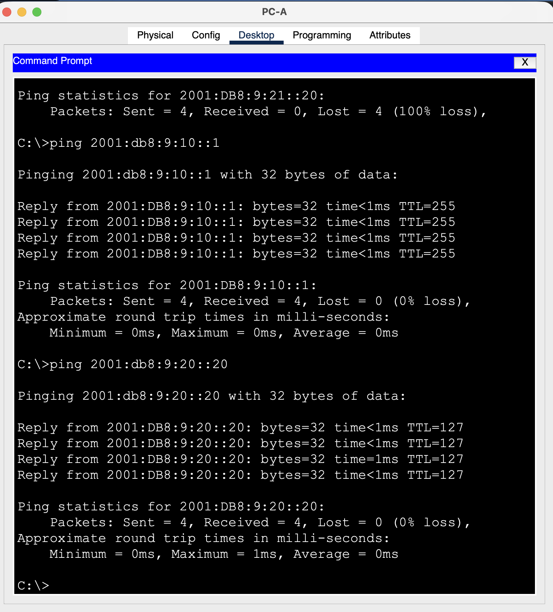
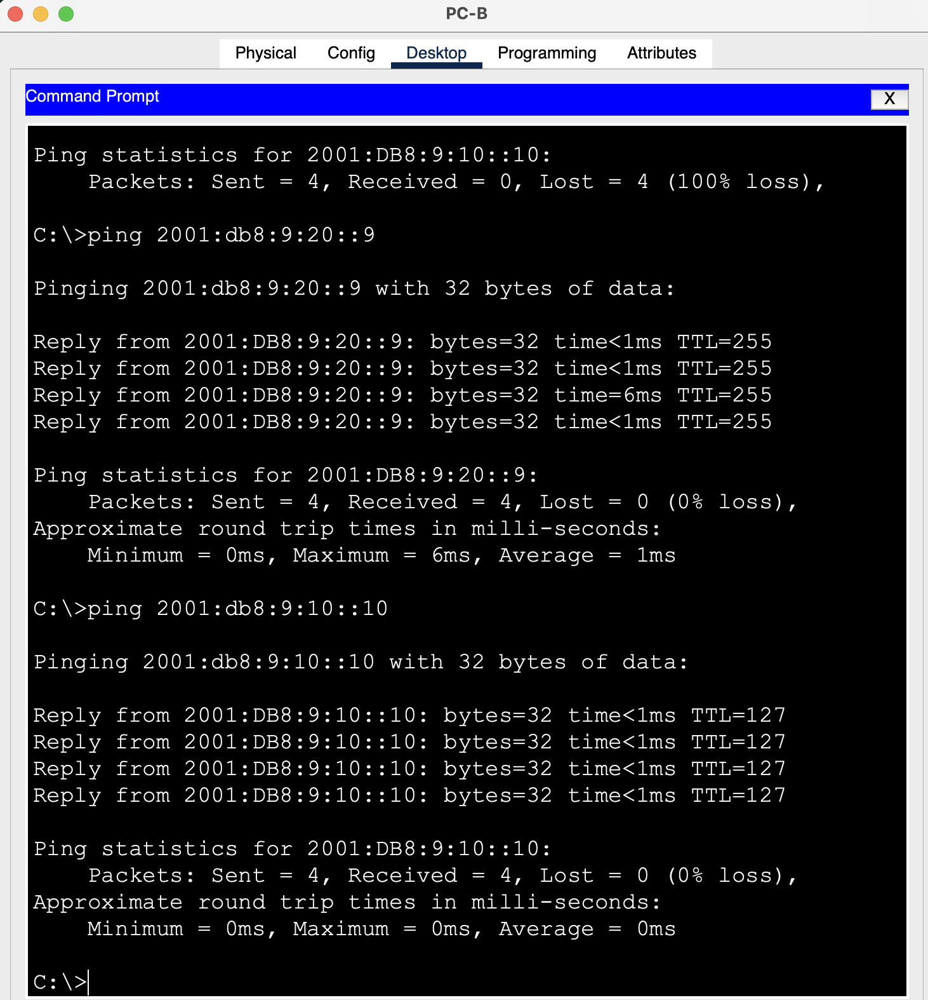
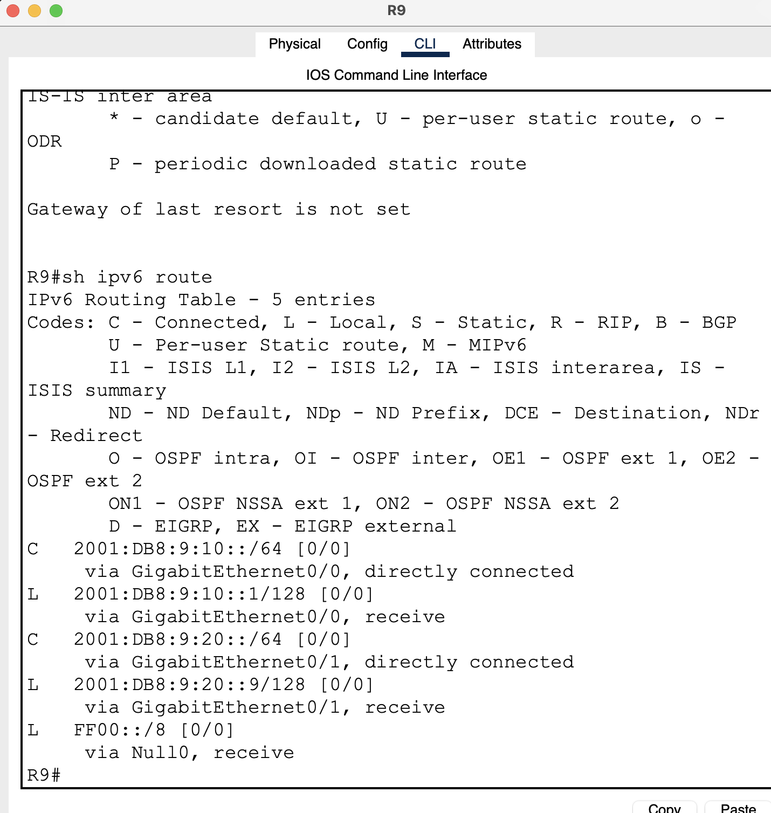

# L09 · IPv6 prefixes, interface identifiers and a client prefix fault

**Practical completion:** 14 November 2026, after guided review of baseline, interface identifiers, controlled fault, rollback and recovery. The case separates a theoretical MAC-derived IID from the router's actual IOS behavior, then diagnoses a PC address placed in the wrong /64. Commands are reproduction instructions, not a fresh publication-time execution transcript.

## Topology and address plan

```text
PC-A -- S9A -- R9 Gi0/0
PC-B -- S9B -- R9 Gi0/1
```

Each switch provides a separate default-VLAN LAN; there is no inter-switch link. R9 routes between them. Use straight-through PC–switch and switch–router links. IPv4, DNS and dynamic routing are outside the scope of this lab.

| Device / interface | Global IPv6 address | Prefix length | Link-local / default gateway |
|---|---|---|---|
| R9 Gi0/0 | 2001:db8:9:10::1 | /64 | Router link-local fe80::9 |
| PC-A | 2001:db8:9:10::10 | /64 | Gateway fe80::9 on its local link |
| R9 Gi0/1 | **Observed:** 2001:db8:9:20::9 | /64 | Router link-local fe80::9 |
| PC-B | 2001:db8:9:20::20 | /64 | Gateway fe80::9 on its local link |

The LAN prefixes are `2001:db8:9:10::/64` and `2001:db8:9:20::/64`. These addresses use the documentation prefix. The repeated router link-local value is valid on separate links because its scope is the individual link; it is not a global address or a route through the other LAN. IPv6 has no IPv4-style broadcast address.

## Configure and inspect the working baseline

On a separate working copy, first inspect the actual interface names and Gi0/1 MAC. Starting from privileged EXEC, the lab configuration is:

```text
show interfaces GigabitEthernet0/1
configure terminal
hostname R9
ipv6 unicast-routing
interface GigabitEthernet0/0
 ipv6 address 2001:db8:9:10::1/64
 ipv6 address fe80::9 link-local
 no shutdown
exit
interface GigabitEthernet0/1
 ipv6 address 2001:db8:9:20::/64 eui-64
 ipv6 address fe80::9 link-local
 no shutdown
end
show ipv6 interface brief
show ipv6 interface GigabitEthernet0/0
show ipv6 interface GigabitEthernet0/1
show ipv6 route
show ipv6 neighbors
copy running-config startup-config
```

Set both PCs statically using the address plan. Observe the actual Gi0/1 global address before testing it from PC-B. Repeat initially lost tests after Duplicate Address Detection and Neighbor Discovery have settled, and retain the actual outcomes.

| Command / context | Purpose | Interpretation / pitfall |
|---|---|---|
| `ipv6 unicast-routing` · global configuration | Enable forwarding between IPv6 links | Addressing interfaces alone does not establish routed forwarding |
| `ipv6 address <prefix>/64 eui-64` · interface | Request an IID-based global address | Manual link-local configuration can affect the IID used by IOS |
| `ipv6 address fe80::9 link-local` · interface | Set the local router identity | Do not use a remote link's link-local address as though globally scoped |
| `show interfaces GigabitEthernet0/1` · EXEC | Inspect current interface MAC and BIA | Use the current MAC for the theoretical calculation |
| `show ipv6 interface ...` · EXEC | Inspect actual global/link-local addresses and prefix | Read the output rather than assuming the configured method implies a particular IID |
| `show ipv6 route` · EXEC | Inspect IPv6 connected and local routes | `show ip route` is the IPv4 table and cannot establish the IPv6 routes |
| `show ipv6 neighbors` · EXEC | Inspect IPv6 neighbor mappings after traffic | IPv4 ARP is a separate mechanism |
| PC `ping <IPv6-address>` | Compare local and cross-LAN echo exchanges | Check the source address, destination and return path |

## MAC-derived EUI-64 versus the actual IOS address



For the observed MAC `00:e0:a3:15:be:02`, the theoretical modified EUI-64 calculation is:

1. Insert `ff:fe` between the first and last three octets: `00:e0:a3:ff:fe:15:be:02`.
2. Invert the U/L bit of the first octet: `00 XOR 02 = 02`.
3. Group the result into IID `02e0:a3ff:fe15:be02`.
4. Combine it with the Gi0/1 prefix: `2001:db8:9:20:2e0:a3ff:fe15:be02`.

That is the MAC-based calculation, **not the address observed on this configured interface**. The screenshot below shows `2001:db8:9:20::9/64 [EUI]` alongside manually configured `fe80::9`.



IOS can reuse the manually configured link-local IID when forming a global address with `eui-64`, as explained by [Cisco employee Peter Paluch](https://community.cisco.com/t5/ipv6/manually-configuring-link-local-global-unicast-cannot-use-eui-64/m-p/3310648). The observed result is consistent with that behavior. Do not treat the working `::9` address as an incorrect MAC calculation or change it merely to make the output match the theoretical result. The actual-versus-theoretical distinction was clarified during guided review; no separate experiment without the manual link-local setting is claimed.

The accepted baseline included both /64s, router interfaces, client addresses, local pings, bidirectional remote pings, neighbor/route checks and a startup save.

## Fault: move PC-B into an unconnected prefix

Change **only PC-B's global address from `2001:db8:9:20::20` to `2001:db8:9:21::20`**. Keep prefix length 64, gateway `fe80::9`, router settings and all links unchanged. Check that another correctly addressed global source is not masking the intended experiment.



| Source | Destination | Reviewed fault result |
|---|---|---|
| PC-A | Local R9 2001:db8:9:10::1 | 4/4 echo replies |
| PC-A | PC-B's old 2001:db8:9:20::20 | 0/4 echo replies; timeout |
| PC-A | PC-B's changed 2001:db8:9:21::20 | 0/4 echo replies; destination-host-unreachable messages from R9 |
| PC-B | PC-A 2001:db8:9:10::10 | 0/4 echo replies; timeout |



An unreachable message is an error response, not a successful echo reply from PC-B. R9's intended connected prefixes are `:10::/64` and `:20::/64`; changing PC-B to `:21::20/64` does not create a connected route for `:21::/64`. Keeping a usable link-local next hop also does not make every global source/destination prefix routable. The request and return paths must both be valid.

## Restore PC-B and verify both directions

Restore **only PC-B's global address to `2001:db8:9:20::20/64`**, keeping gateway `fe80::9`. Repeat these recovery checks:

| Source | Local router | Remote PC | Reviewed result |
|---|---|---|---|
| PC-A | 2001:db8:9:10::1 | 2001:db8:9:20::20 | 4/4 for each |
| PC-B | 2001:db8:9:20::9 | 2001:db8:9:10::10 | 4/4 for each |





Old failed tests remain visible above the new successful commands in these terminal captures. They are historical fault output, not new recovery failures.



The final `show ipv6 route` capture is from the **recovered state**. It shows connected `:10::/64` and `:20::/64` and the router's local addresses; no `:21::/64` or IPv6 default route appears. It is not relabeled as a fault-time route capture. An earlier fault-phase screenshot used `show ip route`; that IPv4 command did not prove anything about the IPv6 table. No route was added to accommodate the deliberately wrong client prefix.

PC-B and R9 Gi0/1 share `:20::/64` after recovery. PC-A remains on a different /64 and communicates through R9. Restoring PC-B to the configured destination network restores the tested forwarding and return path.

## Saved projects and rollback

| Intended state | Download |
|---|---|
| Baseline | [L09-baseline.pkt](../packet-tracer/L09-baseline.pkt) |
| PC-B prefix fault | [L09-prefix-fault.pkt](../packet-tracer/L09-prefix-fault.pkt) |
| Recovery | [L09-recovered.pkt](../packet-tracer/L09-recovered.pkt) |

The available learner-saved files were copied unchanged and fingerprinted at publication. Project internals and exact original save timing were not independently inspected. The available recovery file differs from the fingerprint recorded during the original completion review; the manifest identifies the actual published file. Check its configuration after opening a separate working copy. Roll back by restoring PC-B's original address, or reopen an untouched baseline copy if the working state is unclear. No fresh simulator rerun is claimed.

**Takeaway:** verify both the prefix and the actual interface identifier. A correct local next hop does not compensate for an incorrect global prefix, and an IPv4 route command cannot validate IPv6 routing.

[RFC 4861 — IPv6 Neighbor Discovery](https://www.rfc-editor.org/rfc/rfc4861.html) · [Next lab: dual-stack gateway fault](L10-dual-stack-gateway.md) · [Command reference](../docs/COMMANDS.md) · [Evidence scope](../docs/EVIDENCE_POLICY.md) · [Index](../README.md)
