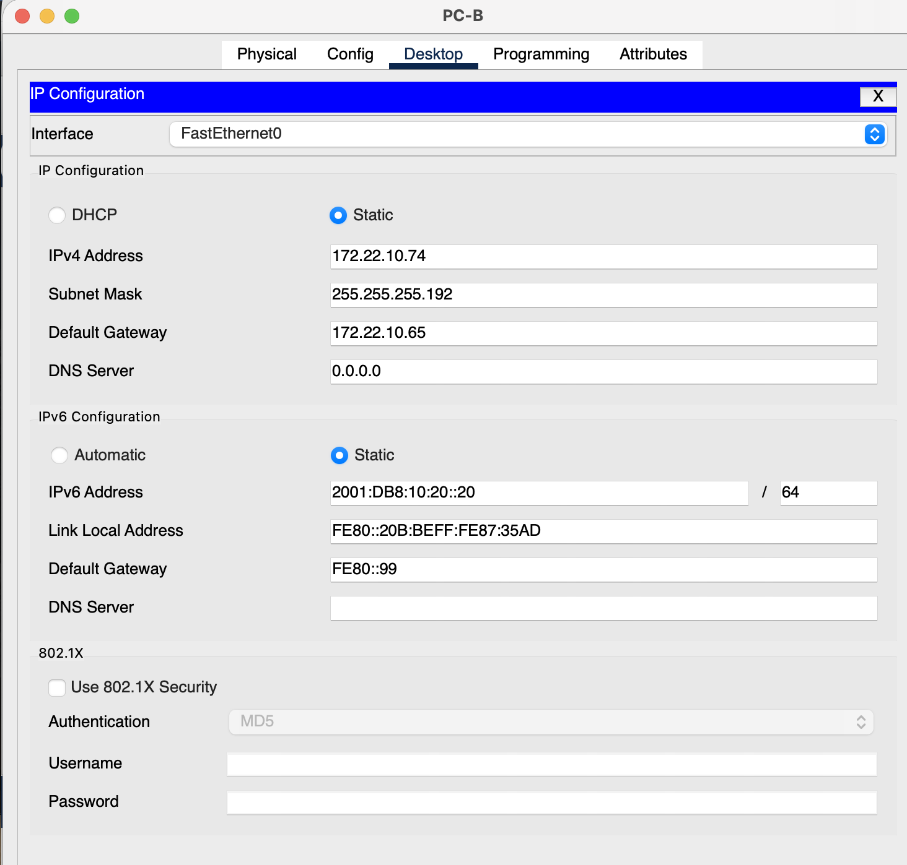
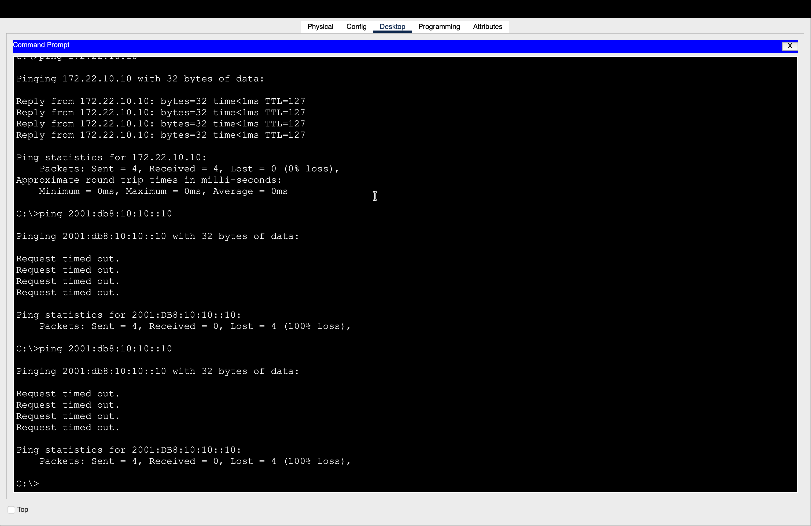
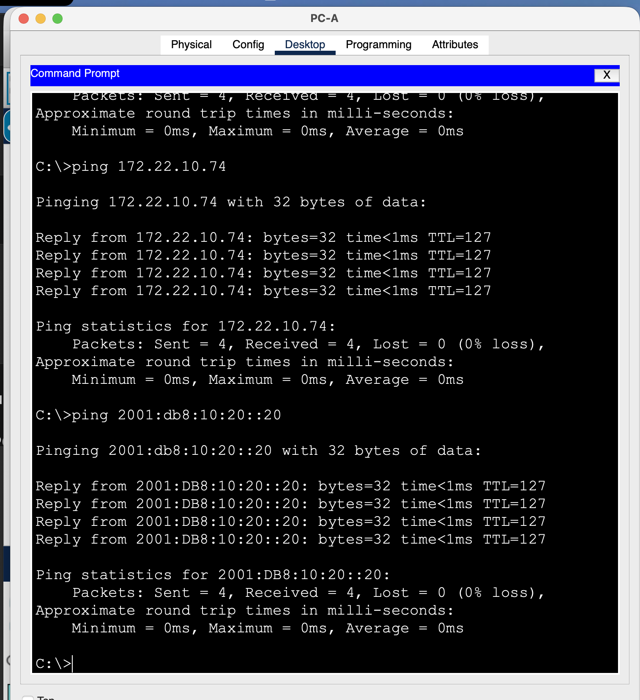

# L10 · IPv4 works, IPv6 fails: a client gateway fault

**Practical completion:** 15 November 2026, after guided corrections and reviewed baseline, fault and recovery screenshots. The case isolates one incorrect IPv6 default gateway while preserving working IPv4. The commands explain reproduction and verification; they are not a fresh execution transcript from repository preparation.

## Scenario and addressing

PC-A connects through S10A to R10 Gi0/0; PC-B connects through S10B to R10 Gi0/1. The switches provide separate VLAN 1 LANs with no inter-switch link. R10 routes between the two LANs for both address families. No DNS, NAT, external service or dynamic routing is needed for these literal-address tests.

| Device / interface | IPv4 address | IPv6 global address | Default gateways |
|---|---|---|---|
| R10 Gi0/0 | 172.22.10.1/26 | 2001:db8:10:10::1/64 | Router interface; link-local fe80::10 |
| PC-A | 172.22.10.10/26 | 2001:db8:10:10::10/64 | 172.22.10.1; fe80::10 |
| R10 Gi0/1 | 172.22.10.65/26 | 2001:db8:10:20::1/64 | Router interface; link-local fe80::10 |
| PC-B | 172.22.10.74/26 | 2001:db8:10:20::20/64 | 172.22.10.65; fe80::10 |

The IPv4 mask is `255.255.255.192`. The IPv4 networks are `172.22.10.0/26` and `172.22.10.64/26`; the IPv6 prefixes are the two /64s above. Reusing R10's link-local `fe80::10` on different links is valid because link-local addresses are scoped to their interfaces/links.

During baseline review, client masks and PC-A's IPv6 address were corrected before the controlled gateway fault was introduced. This case starts from the accepted baseline; it does not mix those earlier corrections into the one-change fault experiment.

## Establish a working baseline

On R10, starting from privileged EXEC, this reproduction configuration uses the interface names in the lab:

```text
configure terminal
hostname R10
ipv6 unicast-routing
interface GigabitEthernet0/0
 ip address 172.22.10.1 255.255.255.192
 ipv6 address 2001:db8:10:10::1/64
 ipv6 address fe80::10 link-local
 no shutdown
interface GigabitEthernet0/1
 ip address 172.22.10.65 255.255.255.192
 ipv6 address 2001:db8:10:20::1/64
 ipv6 address fe80::10 link-local
 no shutdown
end
```

Configure each PC under Desktop → IP Configuration using the table. Inspect both families independently, then ping the local router and remote PC using both addresses. Confirm the settled results after any initial address-resolution loss.

| Command / location | Purpose | Interpretation / pitfall |
|---|---|---|
| `ipv6 unicast-routing` · global configuration | Enable IPv6 forwarding between R10's links | IPv6 addresses alone do not establish inter-LAN forwarding |
| `ipv6 address ... link-local` · interface configuration | Set the host's intended local next hop | A link-local address is not forwarded across the router |
| `show ip interface brief` / `show ipv6 interface brief` · EXEC | Inspect addresses and interface state for each family | One family working does not validate the other's addressing |
| `show ip route` / `show ipv6 route` · EXEC | Check the two connected networks and local routes | These directly connected LANs do not require extra static routes |
| `show ip arp` / `show ipv6 neighbors` · EXEC | Inspect IPv4 ARP and IPv6 Neighbor Discovery mappings | ARP is not the IPv6 resolution protocol |
| PC `ping <literal-address>` | Separate local, remote, IPv4 and IPv6 reachability | An echo exchange needs a valid return path too |
| `copy running-config startup-config` · EXEC | Preserve R10's configuration | Save the Packet Tracer project separately |

## Fault: change one IPv6 setting

On PC-B only, the IPv6 default gateway was changed from **`fe80::10` to unowned `fe80::99`**. Its IPv4 settings, global IPv6 address and /64 prefix were retained. The router configuration and PC-A settings were left in place.



The observed fault-state results were:

| Source | Destination | Result |
|---|---|---|
| PC-B | Local R10 IPv4 `172.22.10.65` | 4/4 replies |
| PC-B | Local R10 IPv6 `2001:db8:10:20::1` | 4/4 replies |
| PC-B | Remote PC-A IPv4 `172.22.10.10` | 4/4 replies |
| PC-B | Remote PC-A IPv6 `2001:db8:10:10::10` | 0/4 replies, repeated |
| PC-A | Remote PC-B IPv4 `172.22.10.74` | 4/4 replies, repeated |
| PC-A | Remote PC-B IPv6 `2001:db8:10:20::20` | 0/4 replies |



The PC-B title is cropped from this particular fault capture; its source attribution comes from the reviewed capture sequence and companion PC-B settings/local tests. The results themselves are visible.

## Diagnosis: the return path matters

Local IPv6 communication still worked because the router's local global address was on PC-B's own link. Remote IPv6 needed a valid router next hop, but PC-B's configured `fe80::99` did not identify R10. Working IPv4 and local IPv6 helped narrow the problem to off-link IPv6 delivery rather than a completely disconnected client.

**Why did PC-A's IPv6 ping also fail?** Even if the request reaches PC-B, the echo reply is addressed to PC-A on a different /64. PC-B needs its IPv6 gateway to send that reply back. A correct route on PC-A does not repair PC-B's return path. This is the diagnosis supported by the controlled change and recovery; no packet capture tracing every failed request/reply is claimed.

Use the client settings plus R10's family-specific interface, route and neighbor checks to distinguish an incorrect client next hop from a router forwarding fault. Testing with literal addresses also avoids adding DNS to this experiment.

## Solution and recovery validation

Restore **only PC-B's IPv6 default gateway to `fe80::10`**. Keep all other addressing and R10 settings unchanged. Repeat the same tests; do not treat an old timeout left in the terminal as a new recovery test.

The final reviewed recovery contained eight successful checks:

| Source | Local router tests | Remote PC tests | Accepted result |
|---|---|---|---|
| PC-A | `172.22.10.1`; `2001:db8:10:10::1` | `172.22.10.74`; `2001:db8:10:20::20` | 4/4 replies for each target |
| PC-B | `172.22.10.65`; `2001:db8:10:20::1` | `172.22.10.10`; `2001:db8:10:10::10` | 4/4 replies for each target |



Only three screenshots are selected: the changed setting, the contrasting fault results and recovered remote connectivity. The table summarizes the wider reviewed test set without repeating similar terminal images.

## Saved projects and reproduction

| State | Download | Use |
|---|---|---|
| Baseline | [L10-baseline.pkt](../packet-tracer/L10-baseline.pkt) | Accepted working baseline archive |
| Fault | [L10-IPv6-gateway-fault.pkt](../packet-tracer/L10-IPv6-gateway-fault.pkt) | Separate saved fault-state archive |
| Recovery | [L10-recovered.pkt](../packet-tracer/L10-recovered.pkt) | Saved recovery archive from the completion review |

These files come from the preserved snapshots associated with the final review. Their bytes are fingerprinted; the `.pkt` internals were not independently inspected or rerun during publication. Open a separate working copy, verify its actual configuration and use the addressing/test tables to compare results. To roll back an experiment, restore `fe80::10` and repeat the local/remote checks; if the state is unclear, reopen a separate baseline copy.

## What this case demonstrates

A working IPv4 path does not establish working IPv6. Checking both address families and both directions isolates a client gateway error that can otherwise look like a remote routing problem. Preserve the fault scope, change one setting, and verify the return path before declaring recovery.

- [RFC 4861: Neighbor Discovery, next-hop determination and default router selection](https://www.rfc-editor.org/rfc/rfc4861.html)
- [Related IPv4 case: client gateway](L05-client-gateway.md)
- [Command reference](../docs/COMMANDS.md) · [Evidence scope](../docs/EVIDENCE_POLICY.md) · [Index](../README.md)
