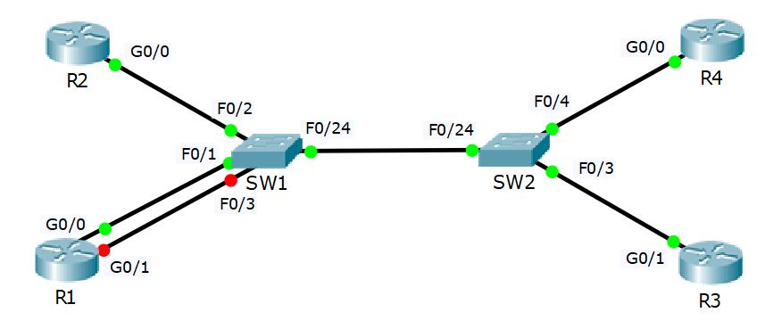

# U11 · Cisco device functions

**Completion:** learner-reported on 5 November 2026. **Basis:** local course project and reviewed exercise material where available.



*Topology supplied with the course materials; it is not a learner execution screenshot.*


## Scenario

Four routers connect through two switches in 10.10.10.0/24. The exercise compares router interface/route information with the switches' learned MAC paths, then introduces another connected subnet and a static route.

## Commands and reasoning

```text
enable
show ip interface brief
show interfaces gigabitEthernet 0/0
show mac address-table dynamic
show ip route
```

Use the interface present on each device: in the course topology R3 uses Gi0/1 for 10.10.10.3, while R1/R2/R4 use Gi0/0. Inspect live MAC addresses rather than copying the worksheet's examples. Switch tables can show multiple remote router MACs behind the inter-switch uplink.

On the intended R1 interface, a concise configuration example is:

```text
configure terminal
interface gigabitEthernet 0/1
 ip address 10.10.20.1 255.255.255.0
 no shutdown
end
show ip interface brief
show ip route
```

`ip address` supplies Layer 3 parameters; `no shutdown` removes administrative disable. A connected route requires an operational interface, not just an address typed into configuration. Inspect physical/link state if it remains down.

The exercise's static-route example is `ip route 10.10.30.0 255.255.255.0 10.10.10.2`, entered in global configuration. It directs that remote prefix to a reachable next hop; it does not configure the destination network on R1 itself.

## Situation, solution and validation

If an added subnet is missing from the routing table, verify the selected interface, address/mask, administrative state and link. Enable the intended interface and resolve its link before checking `C` (connected) and `L` (local) entries. Generate traffic before interpreting dynamic MAC tables; clearing learning state does not guarantee it stays empty.

Verify neighbor pings, interface states, learned ports and the static route. Preserve a working copy before changes. Completion is learner-reported; the course's example outputs are reference material, not Marcelo's captured results.

[Packet Tracer project](../packet-tracer/U11-device-functions.pkt) · [Course attribution](../ATTRIBUTION.md) · [Command reference](../docs/COMMANDS.md) · [Index](../README.md)
