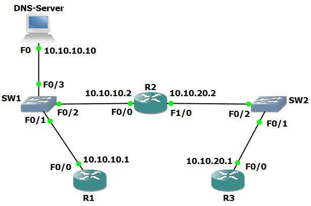

# U12 · The life of a packet: DNS and ARP

**Completion:** learner-reported on 5 November 2026. **Basis:** local course project and reviewed exercise material where available.



*Topology supplied with the course materials; it is not a learner execution screenshot.*


## Scenario

R1 and R2 share 10.10.10.0/24 with a DNS server at 10.10.10.10. R2 also connects to R3 on 10.10.20.0/24. The supplied exercise already provides static routes between the networks. Router names are DNS records; no DNS domain suffix is required for these short-name tests.

## Configuration and commands

On the routers, the reference configuration is:

```text
enable
configure terminal
ip domain-lookup
ip name-server 10.10.10.10
end
ping R2
ping R3
show arp
show ip route
```

`ip domain-lookup` allows DNS lookup; `ip name-server` identifies the resolver. `show arp` lists IPv4-to-MAC mappings for reachable local next hops. Packet Tracer's Server-PT supplies DNS in this exercise; the worksheet does not rely on an IOS router acting as a DNS server.

## Diagnostic situations and solutions

| Symptom | Investigation | Correction to apply if confirmed |
|---|---|---|
| IP ping works but a short hostname fails | Check resolver address, lookup setting and server record/service | Use the intended resolver and correct its DNS service/record |
| Remote IP does not appear in local ARP | Compare destination subnet and routing next hop | Expect ARP for the local next hop; no repair is needed for this alone |
| Both name and IP tests fail | Check routes and local connectivity first | Repair the proven path fault before changing DNS |

R1's ARP cache should identify R2's local next-hop MAC for traffic to R3's remote subnet; an entry for remote R3 is not required. R2 has on-link mappings from both attached subnets. DNS name resolution and ARP link-layer resolution solve different problems.

## Validation and rollback

Test numeric addressing and hostname addressing separately in both directions, inspect `show arp`, and compare the selected route. Revert only the resolver configuration changed during practice or reopen the working copy. Completion is learner-reported; these are exercise-derived steps and expected reasoning, with no fabricated ping transcript.

[Packet Tracer project](../packet-tracer/U12-packet-life.pkt) · [Course attribution](../ATTRIBUTION.md) · [Command reference](../docs/COMMANDS.md) · [Index](../README.md)
