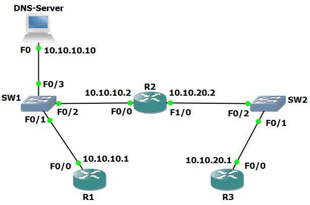

# U13 · Cisco troubleshooting methodology

**Completion:** learner-reported on 5 November 2026. **Basis:** local course project and reviewed exercise material where available.



*Topology supplied with the course materials; it is not a learner execution screenshot.*


## Scenario and source-defined problems

Users report that the new DNS server at 10.10.10.10 cannot resolve router names. The course troubleshooting case contains three issues: **R2 Fa0/0 administratively disabled, the wrong resolver configured on R3, and DNS service stopped on the server**. These are diagnoses documented by the exercise/answer material; Marcelo reported completing the lab, but separate before/after device screenshots were not found.

## Investigation sequence

```text
ping 10.10.10.10
traceroute 10.10.10.10
show ip interface brief
show ip route
show running-config
```

Start with the affected source (R3), test numeric reachability, locate the last responding hop and inspect the adjacent interface/route. Check the resolver address and Server-PT DNS service after repairing the proven path fault. Make one correction at a time, retesting after each.

## Corrections explained

On R2, after verifying the port identity:

```text
configure terminal
interface fastEthernet 0/0
 no shutdown
end
```

On R3, inspect existing resolver configuration, remove the incorrect `ip name-server` entry with its matching `no` command, and configure `ip name-server 10.10.10.10`. On the server, use Services → DNS → On and check the intended router-name A records.

The worksheet begins with a Telnet attempt. **A plain `telnet 10.10.10.10` targets TCP/23 and does not establish DNS service health.** DNS commonly uses UDP/53 and can also use TCP/53. Use the numeric reachability test plus an actual name-resolution test to establish the relevant behavior. A TCP/23 timeout alone does not prove DNS is broken.

## Validation and rollback

Confirm the repaired interface, numeric server reachability and `ping R1` from R3 after resolution. Test other affected names before saving. Keep the starting fault file and corrected working copy separately. The solution described here follows reviewed course material; exact historical command order and Marcelo's output remain unverified.

[Packet Tracer project](../packet-tracer/U13-troubleshooting-method.pkt) · [Course attribution](../ATTRIBUTION.md) · [Command reference](../docs/COMMANDS.md) · [Index](../README.md)
