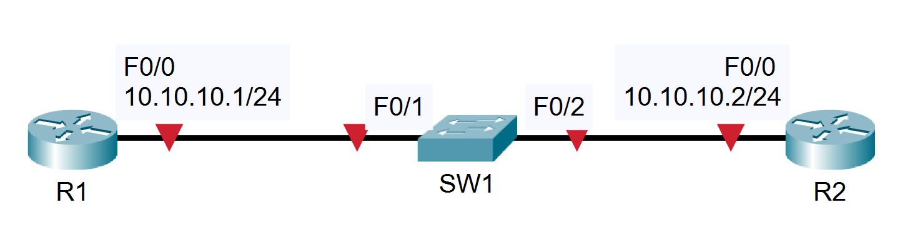

# U14 · Router and switch basics, CDP, speed and duplex

**Completion:** learner-reported on 5 November 2026. **Basis:** local course project and reviewed exercise material where available.



*Topology supplied with the course materials; it is not a learner execution screenshot.*


## Scenario

Two routers attach to SW1. The exercise sets hostnames, router IP addresses and a switch management SVI at 10.10.10.10/24, using R2 for access to other subnets. It then changes CDP advertisement, interface state, duplex and speed.

## Configuration and command explanations

| Command / setting | Purpose | Verification |
|---|---|---|
| `hostname SW1` | Identify the switch | CLI prompt / running configuration |
| `interface vlan 1` + `ip address 10.10.10.10 255.255.255.0` | Set the management SVI | `show ip interface brief` |
| `ip default-gateway <R2-LAN-IP>` | Management next hop for this Layer 2 switch | Ping gateway and a remote destination |
| Interface `description ...` | Document the actual link | `show interfaces description` if supported |
| `show cdp neighbors detail` | Inspect direct Cisco neighbors | Compare remote port/device |
| Interface `no cdp enable` | Stop CDP on one link | Refresh/check the receiving neighbor table |
| `show version` | Inspect the IOS/model version | Read actual output |

`<R2-LAN-IP>` is an explanatory placeholder, not a literal command; use the topology's actual R2 interface address. A management SVI also needs the appropriate VLAN/link operational conditions; an IP address alone is insufficient.

## Controlled problems and solutions

An interface `shutdown` causes administrative down state; restore the same port using `no shutdown`. The exercise then deliberately sets half duplex against the other end's settings and reduces switch speed to 10 Mb/s. Inspect both ends with `show interfaces` and `show interfaces status` where supported.

```text
configure terminal
interface <verified-port>
 duplex full
 speed 100
end
```

This is an example of matching explicit FastEthernet settings, not a universal prescription. Alternatively restore compatible auto-negotiation on both ends if that was the baseline. A duplex mismatch can leave a link up while impairing traffic; simulator behavior/counters may differ from hardware. A speed mismatch can prevent the link from operating.

## Validation and rollback

Recheck management reachability, both interface states, negotiated/configured speed/duplex and the intended CDP visibility. Restore the exact initial link settings and CDP state in the lab copy. Completion is learner-reported; supplied topology art is a course diagram, not a captured recovery result.

[Packet Tracer project](../packet-tracer/U14-router-switch-basics.pkt) · [Course attribution](../ATTRIBUTION.md) · [Command reference](../docs/COMMANDS.md) · [Index](../README.md)
