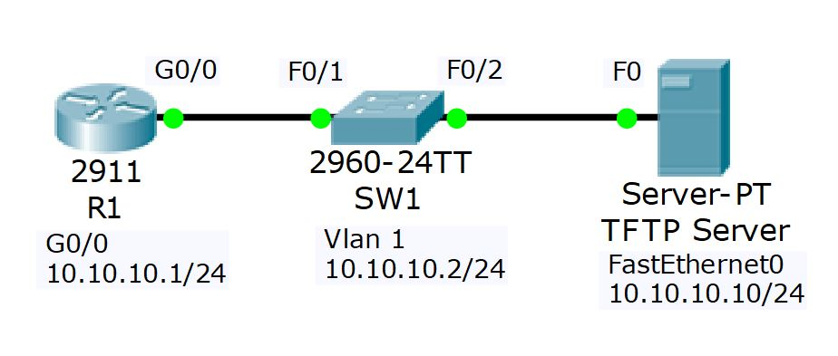

# U15 · Device management, recovery and backups

**Completion:** learner-reported on 5 November 2026. **Basis:** local course project and reviewed exercise material where available.



*Topology supplied with the course materials; it is not a learner execution screenshot.*


## Scenario

An isolated router/switch lab with a TFTP server at 10.10.10.10 covers reset, password recovery, configuration backups, IOS recovery and a switch image change. Marcelo reported completing this exercise. These procedures are documented for the disposable Packet Tracer devices only; no host or production device was changed to assemble this repository.

## Operations and commands

| Operation | Commands / purpose | Validation |
|---|---|---|
| Inspect state | `show running-config`, `show startup-config`, `show version`, `show flash` | Record configuration, model, image and boot settings |
| Factory-reset exercise | `write erase`, then `reload` in the disposable lab | Confirm startup-config removal and restore the intended lab configuration |
| Save IOS settings | `copy running-config startup-config` | Accept destination and inspect the save result |
| Back up active configuration | `copy running-config flash:` | Choose a distinct backup filename and verify it in flash |
| Export startup configuration | `copy startup-config tftp:` | Supply server/file and verify the server copy |
| Back up an image | `copy flash: tftp:` | Use the exact existing image filename |
| Receive a replacement image | `copy tftp: flash:` | Verify image presence and device-specific boot configuration |

## Password-recovery logic

The reference procedure uses `config-register 0x2120` to reach ROMMON, then ROMMON `confreg 0x2142` and `reset` to boot while ignoring startup-config. Ignoring the saved configuration does not delete it.

After entering privileged EXEC, **merge the preserved startup configuration into running configuration before saving**:

```text
copy startup-config running-config
```

Then restore the required interface state and access setting in the simulated lab. Return the configuration register to normal boot (`config-register 0x2102` for this reference platform), save the intended configuration and validate after reload. Saving an empty running configuration too early would overwrite the configuration being recovered. Register/ROMMON behavior is platform-specific.

## Image-recovery and upgrade reasoning

The course deliberately removes the router image after backing it up, causing a boot failure. Recovery uses the model's ROMMON TFTP procedure with its required IP/mask/server/file variables, then verifies a normal boot. Use the actual installed image name and built-in recovery help rather than pasting a filename from another device. The course's switch upgrade targets a different supplied image; inspect `show version` after reboot to validate it.

**Repository scope:** no IOS binaries or full course PDFs are redistributed here. The available `.pkt` is archived as supplied, not independently certified as every intermediate recovery stage. Keep separate snapshots/backups for practice; restore the known configuration, boot register, interface state and selected image before finishing.

[Packet Tracer project](../packet-tracer/U15-device-management.pkt) · [Course attribution](../ATTRIBUTION.md) · [Command reference](../docs/COMMANDS.md) · [Index](../README.md)
