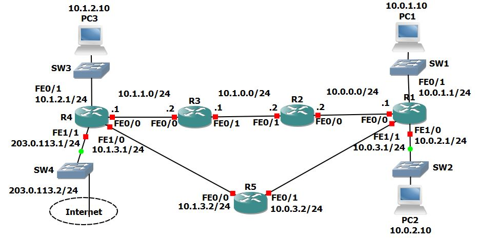

# U16 · Connected, static, summary and default routes

**Completion:** learner-reported on 5 November 2026. **Basis:** local course project and reviewed exercise material where available.



*Topology supplied with the course materials; it is not a learner execution screenshot.*


## Scenario

A five-router topology with PCs begins with unconfigured network devices and pre-addressed PCs. The exercise builds directly connected/local routes, then remote static routing, a summary, more-specific paths and default routes. The service-provider link is simulated; the topology does not provide real Internet access.

## Command explanations

```text
show ip interface brief
show ip route
show ip route 10.1.2.10
```

The interface summary checks the prerequisites for connected routes. The routing table identifies prefix, source, next hop and exit path. A destination lookup helps explain the actual longest-prefix choice rather than judging a route by administrative distance alone.

| Reference syntax in global configuration | Meaning |
|---|---|
| `ip route <prefix> <mask> <next-hop>` | Install a static route for a remote destination |
| `no ip route <prefix> <mask> <next-hop>` | Remove the specific intended route |
| `ip route 0.0.0.0 0.0.0.0 <next-hop>` | Use a default for otherwise unmatched destinations |

Angle-bracket fields must be replaced from the actual topology. Configure and verify routes in **both** directions: a forward path alone cannot deliver a ping reply.

## Situations and solutions

1. **Connected subnet missing:** inspect IP/mask, `no shutdown` and operational link before adding a redundant static route.
2. **Local PC works, remote PC fails:** inspect the first router lacking the remote prefix and the return route; add only the required next-hop route.
3. **Removing R1's remote /24s breaks connectivity:** replace them with the intended covering summary only after confirming its address boundaries and reachable next hop.
4. **Unexpected detour/asymmetric return via R5:** compare destination matches on both routers. A more-specific matching route wins over a broader route, even when the broader route has a lower AD.
5. **Unknown destinations lack a path:** configure the intended provider-facing default and the required internal reachability. Equal eligible static defaults can supply the exercise's parallel paths, but actual per-flow forwarding must be checked.

## Validation and rollback

Ping between PC1/PC2/PC3, run PC `tracert` for both directions where relevant, inspect every changed route and compare the intended next hop. Keep the initial and completed copies separate. The course completion is learner-reported; reference path expectations are not claimed as fresh captured results.

[Packet Tracer project](../packet-tracer/U16-routing-fundamentals.pkt) · [Course attribution](../ATTRIBUTION.md) · [Command reference](../docs/COMMANDS.md) · [Index](../README.md)
