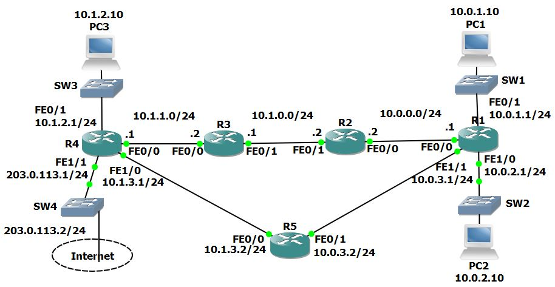

# U17 · Dynamic routing behavior and failover

**Completion:** learner-reported on 5 November 2026. **Basis:** local course project and reviewed exercise material where available.



*Topology supplied with the course materials; it is not a learner execution screenshot.*


## Scenario

The multi-router topology compares RIP versions, OSPF, EIGRP, routing databases, convergence, administrative distance, floating backup routes, loopbacks and passive interfaces. These protocols are studied in separate phases; metric values from different protocols are not directly comparable.

## Configuration examples and commands

```text
router rip
 network 10.0.0.0
 version 2
 no auto-summary
```

RIPv1 uses broadcast updates in this comparison; RIPv2 normally uses 224.0.0.9 multicast. `debug ip rip` can show the updates in this isolated lab; finish with `undebug all`. Inspect `show ip rip database` and `show ip route` separately.

```text
router ospf 1
 network 10.0.0.0 0.255.255.255 area 0
```

The process ID identifies the local OSPF process. The wildcard statement selects matching local interfaces and their area. Inspect `show ip ospf database` as well as routes; the link-state database is not simply a copy of the forwarding table.

```text
router eigrp 100
 no auto-summary
 network 10.0.0.0 0.255.255.255
```

The classic EIGRP AS must match between intended neighbors. `show ip eigrp neighbors` checks adjacencies; `show ip protocols` helps check enabled networks and passive configuration.

## Problems, solutions and interpretation

For the same prefix, internal EIGRP's default AD 90 is preferred to OSPF 110 and RIP 120; first verify prefix and route eligibility. A suppressed RIP route in the main table does not necessarily mean RIP stopped exchanging information. Within one protocol, its own metric selects preferred paths.

The exercise shuts R2 Fa0/0 to observe reconvergence, later adds floating static backup reachability when R5 is not participating dynamically, and verifies the alternate path. Use an explicit AD higher than the intended primary dynamic route for a floating backup; a default static AD of 1 would otherwise prefer the static route for the same prefix.

Loopback configuration `interface loopback 0` with `ip address 192.168.0.<router-number> 255.255.255.255` creates a local logical interface. Advertise the intended loopbacks under the routing process before expecting remote reachability. These are templates requiring actual numeric values.

Under EIGRP, making R1's R5-facing interface passive suppresses hellos and removes that adjacency; this is more than a display setting. A passive loopback does not need a neighbor. Preserve another viable path before deliberately withdrawing a transit adjacency.

## Validation and rollback

Inspect route source/AD/metric before and after each change, ping PC1 → PC3 and compare `tracert` paths. Restore the disabled interface, intended routing processes and passive settings, stop debug, then save. Completion is learner-reported; no course example output is presented as Marcelo's independent capture.

[Packet Tracer project](../packet-tracer/U17-dynamic-routing.pkt) · [Course attribution](../ATTRIBUTION.md) · [Command reference](../docs/COMMANDS.md) · [Index](../README.md)
