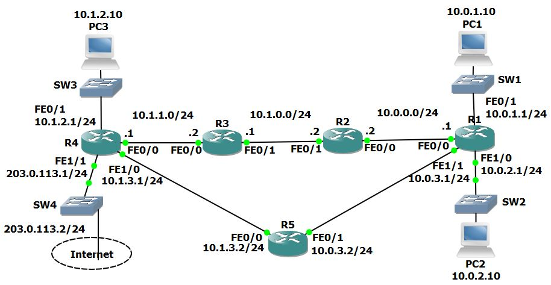

# U18 · Connectivity troubleshooting: a missing static route

**Completion:** learner-reported on 5 November 2026. **Basis:** local course project and reviewed exercise material where available.



*Topology supplied with the course materials; it is not a learner execution screenshot.*


## Scenario

PC1 cannot reach PC3 at **10.1.2.10**. The course topology uses static routes. Its documented fault is a missing route on **R3 to 10.1.2.0/24**, reachable through R4 at **10.1.1.1**.

## Investigation

On PC1:

```text
ping 10.1.2.10
tracert 10.1.2.10
```

The reference troubleshooting trace reaches R3 at 10.1.0.1. Continue there with `show ip route` and a destination lookup. A last replying hop is a place to investigate; it is not by itself proof that the router is defective or that the next router failed.

## Correction explained

After confirming the missing prefix and reachable next hop on R3:

```text
enable
configure terminal
ip route 10.1.2.0 255.255.255.0 10.1.1.1
end
show ip route 10.1.2.10
```

The destination network/mask identifies PC3's LAN; the final address is the neighboring router R4. This command belongs on R3 in this topology. It should not be added indiscriminately to every device.

## Validation and outcome scope

Repeat the ping after initial neighbor resolution, then the trace. Check return routing if replies still fail. A few successful packets after the change establish partial response, not a claimed loss-free repeated test. Save the corrected simulator copy after confirming the intended table and stable repeated probes.

Marcelo reported completing the lab. The exact route correction above comes from reviewed course exercise/answer material; no separate learner command-output or before/after screenshots were present alongside the course file. The supplied `.pkt` may preserve a starting or later state; its internals were not audited during this archive.

**Rollback:** remove only this exact static route if returning to the exercise's fault baseline, or reopen the original practice copy.

[Packet Tracer project](../packet-tracer/U18-connectivity-troubleshooting.pkt) · [Course attribution](../ATTRIBUTION.md) · [Command reference](../docs/COMMANDS.md) · [Index](../README.md)
