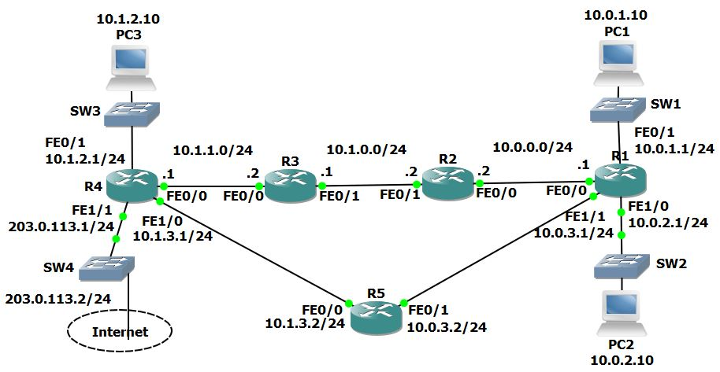

# U19.1 · 19.1 IGP fundamentals: RIPv2 and EIGRP

**Completion:** learner-reported on 5 November 2026. **Basis:** local course project and reviewed exercise material where available.



*Topology supplied with the course materials; it is not a learner execution screenshot.*


## Scenario

The supplied five-router topology already has interface addresses. The exercise configures RIPv2, advertises the provider-facing subnet, originates a default, then adds EIGRP to compare route selection. Marcelo explicitly reported completion **through this lab** on 5 November 2026. Later course labs are not counted as completed here.

## Phase 1 · Internal RIPv2 reachability

On each intended router:

```text
router rip
 version 2
 no auto-summary
 network 10.0.0.0
```

`version 2` enables the exercise's RIPv2 behavior. `no auto-summary` avoids automatic classful summaries. RIP's `network 10.0.0.0` identifies the classful network used to select participating interfaces; it is not an OSPF wildcard statement. Inspect `show ip protocols` and `show ip route`, then test PC1 → PC3 (10.1.2.10).

## Phase 2 · Provider boundary and default route

On R4, the reference provider link is Fa1/1 toward 203.0.113.2:

```text
router rip
 passive-interface fastEthernet 1/1
 network 203.0.113.0
exit
ip route 0.0.0.0 0.0.0.0 203.0.113.2
router rip
 default-information originate
```

The passive interface prevents sending RIP updates containing internal routes toward the provider while the connected provider prefix can still be advertised internally. The static default gives R4 an upstream next hop; default origination teaches the other routers where to send otherwise unmatched traffic. This is a simulated upstream path, not proof of actual Internet connectivity.

## Phase 3 · EIGRP comparison

```text
router eigrp 100
 network 10.0.0.0
```

Use the same classic AS on intended peers. Check `show ip eigrp neighbors`, `show ip protocols`, and `show ip route`. For the same eligible internal prefixes, internal EIGRP AD 90 is preferred over RIP AD 120. The provider prefix and default remain RIP-learned in the exercise because only RIP advertises them; adding EIGRP does not automatically redistribute unrelated routes.

## Troubleshooting and solution map

| Situation | Check | Correction if confirmed |
|---|---|---|
| Remote subnet missing | Matching interfaces, masks, process networks and neighbor/link state | Correct the relevant network selection or interface |
| EIGRP adjacency absent | AS number, common subnet, passive setting and interface state | Align the peer parameters; enable the intended transit participation |
| Internal routers have no default | R4 static default and RIP origination | Add/fix the upstream next hop and intended default advertisement |
| RIP no longer installs an internal prefix | Same-prefix EIGRP route and AD | Expected preference if EIGRP is valid; do not remove a healthy protocol to force the old code |
| Updates sent toward provider | R4 interface identity and passive setting | Apply passive status only to the intended boundary interface |

## Validation and rollback

Verify internal and provider-prefix routes, default next hop, intended neighbor relationships, and repeated PC1 ↔ PC3 tests. Preserve route-table snapshots at the RIP-only and EIGRP-comparison phases. Revert only the process/advertisement changed in a working copy. The narrative explains the reviewed exercise; it does not invent Marcelo's exact final routing table or ping results.

[Packet Tracer project](../packet-tracer/U19-1-igp.pkt) · [Course attribution](../ATTRIBUTION.md) · [Command reference](../docs/COMMANDS.md) · [Index](../README.md)
