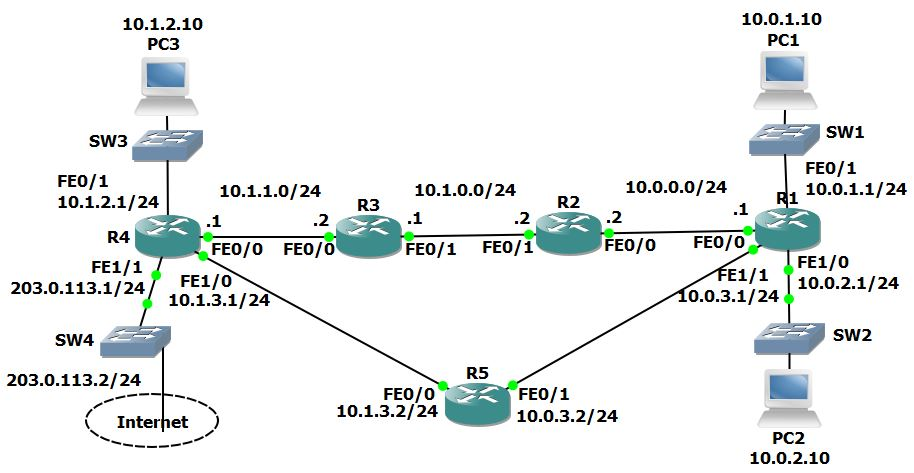
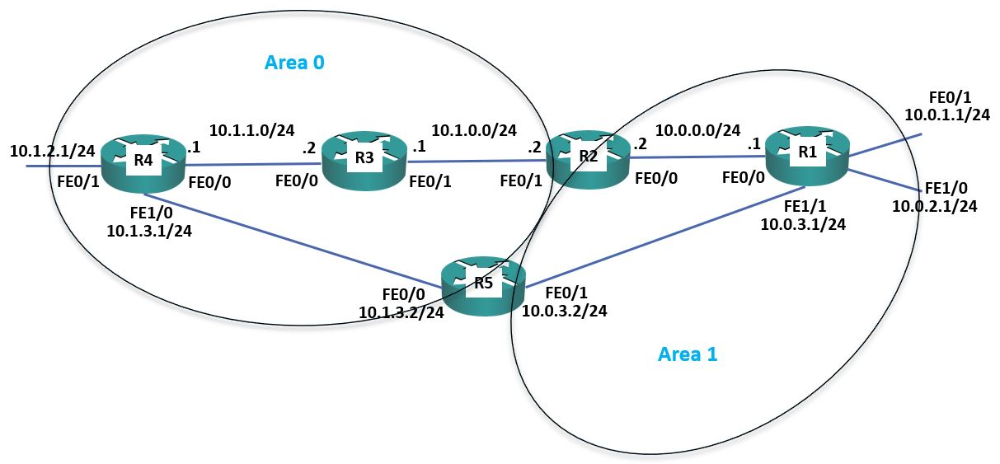
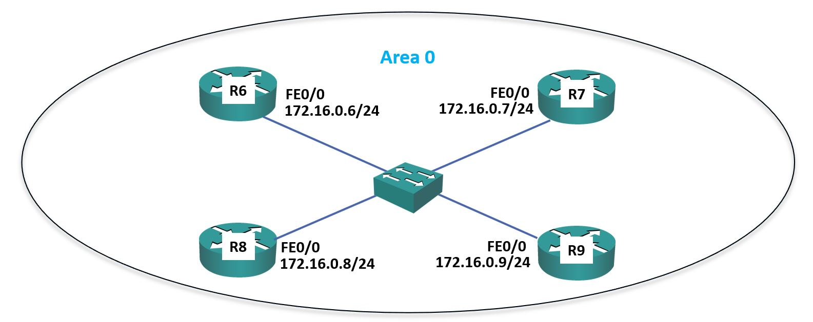

# U20 · OSPF configuration and path selection

**Completion:** reported by Marcelo on 13 November 2026, superseding the earlier request to repeat this lab. [Saved Packet Tracer project](../packet-tracer/U20-ospf.pkt). These notes explain the exercise and its verification method; no fresh simulator run or captured learner transcript is claimed.

## Objective

Build OSPF adjacencies, relate interface costs to selected routes, advertise an upstream default, and then compare single-area routing with ABR summarization. A separate shared-Ethernet segment demonstrates DR/BDR election behavior.

## Scenario



| Routers / networks | Exercise role |
|---|---|
| R1–R5 | Initially one OSPF area 0; two paths connect R1 and R4 |
| 10.0.x.0/24 and 10.1.x.0/24 | Internal transit and destination networks |
| Loopback0, 192.168.0.1–5/32 | Stable addresses used for router-ID selection in the reference setup |
| R4, upstream 203.0.113.2 | Originate a default toward a simulated provider |
| R6–R9, 172.16.0.0/24 | Separate broadcast segment for the DR/BDR exercise |

The supplied images illustrate the course topology. They are not execution screenshots. Open a working copy of the project and inspect its current configuration before reproducing any stage.

## 1. Establish single-area OSPF

The exercise begins with interface addressing in place. Add the assigned /32 loopback on each of R1–R5, then select the intended interfaces for OSPF. Representative process configuration:

```text
router ospf 1
 network 10.0.0.0 0.255.255.255 area 0
 network 192.168.0.0 0.0.0.255 area 0
 auto-cost reference-bandwidth 100000
```

The `network` statements match local interface addresses; the wildcard is not a subnet mask. Process ID 1 is locally significant and does not have to match a neighbor's process ID. Initially, the provider subnet and the separate 172.16.0.0/24 segment are outside this R1–R5 configuration.

The reference bandwidth is in Mbps: 100000 represents 100 Gbps. Apply the same reference consistently across these routers. An automatically calculated 100 Mbps FastEthernet interface then has cost 1000, unless an explicit cost overrides it. This changes OSPF's calculation, not the interface's physical speed.

Inspect `show ip ospf`, `show ip ospf neighbor`, `show ip ospf interface` and `show ip route`. An explicitly configured router ID takes precedence; otherwise IOS selects from eligible loopbacks, then other eligible interface addresses when the process chooses its ID. Adding a loopback later does not automatically replace an active process's router ID.

## 2. Explain the route before changing cost

For destination 10.1.2.0/24 on R4, the reference single-area comparison is:

| Path from R1 | Cost with the common reference bandwidth |
|---|---|
| R1 → R5 → R4 → destination interface | 3000 |
| R1 → R2 → R3 → R4 → destination interface | 4000 |

OSPF adds the outgoing interface costs along the path, including R4's interface to the destination network. Confirm the real interface costs and installed next hop before assuming these reference totals match the saved project's current stage.

The exercise changes both directions of the R1–R5 and R5–R4 links to 1500:

| Router | Interfaces receiving `ip ospf cost 1500` |
|---|---|
| R1 | FastEthernet1/1 |
| R5 | FastEthernet0/1 and FastEthernet0/0 |
| R4 | FastEthernet1/0 |

Enter the command in each listed interface's configuration context. The R5 path to 10.1.2.0/24 now totals 4000, matching the R2 path. Check `show ip route 10.1.2.0` for both next hops. Two eligible equal-cost next hops demonstrate ECMP; they do not promise an exact 50/50 split or alternating packets in every test.

## 3. Advertise a usable upstream default

On R4, the reference provider-facing port is FastEthernet1/1. Advertise its connected subnet while preventing an OSPF adjacency with the provider:

```text
router ospf 1
 network 203.0.113.0 0.0.0.255 area 0
 passive-interface FastEthernet1/1
exit
ip route 0.0.0.0 0.0.0.0 203.0.113.2
router ospf 1
 default-information originate
```

An OSPF passive interface suppresses Hellos and adjacency formation while its selected connected subnet remains advertised. A route to 203.0.113.0/24 alone is not a route to every upstream destination. The static default supplies R4's next hop, and `default-information originate` advertises a default to OSPF peers when the normal default-route prerequisite is met. This example does not use `always`.

Inspect R4's installed default and the other routers' learned default, commonly shown as `O*E2` in this exercise. Then test a simulated upstream destination and its return path. The topology does not establish access to the real Internet.

## 4. Introduce areas and explicit summaries



Move R1's selected interfaces to area 1. Keep R3 and R4 in backbone area 0, with R2 and R5 connecting the two areas as ABRs:

| ABR | Area 0 link | Area 1 link |
|---|---|---|
| R2 | 10.1.0.0/24, FastEthernet0/1 | 10.0.0.0/24, FastEthernet0/0 |
| R5 | 10.1.3.0/24, FastEthernet0/0 | 10.0.3.0/24, FastEthernet0/1 |

Remove the earlier broad area-0 network match where it conflicts with the new assignments, then use the appropriate specific statements. Keep R2/R5 loopbacks in area 0 as in the reference. Check actual area membership with `show ip ospf interface` before interpreting routes. Area changes can disrupt adjacencies, so reproduce this transition only in the isolated working copy.

R1 should now distinguish inter-area routes (`O IA`) from intra-area and external routes. Creating areas does not automatically summarize all their prefixes. On both ABRs, the exercise adds:

```text
router ospf 1
 area 0 range 10.1.0.0 255.255.0.0
 area 1 range 10.0.0.0 255.255.0.0
```

The area number identifies the source area being summarized. The `area range` command uses a subnet mask. Check R1 for 10.1.0.0/16 and compare the summary LSAs with the route table. Receiving a summary from two ABRs does not guarantee ECMP: with the earlier higher R1-to-R5 cost, the reference selects R2 for this summary. The LSDB records advertisements; the route table records selected paths.

## 5. Inspect DR/BDR election on shared Ethernet



R6–R9 share 172.16.0.0/24 and use separate 192.168.0.x/32 loopbacks. Enable their intended area-0 interfaces and inspect the interface's network type, priority, elected DR/BDR and neighbor states.

During election, eligible higher interface priority wins; router ID breaks a tie. Priority 0 makes a router ineligible. Existing DR/BDR roles are non-preemptive: a later router with a higher ID or priority does not automatically replace a healthy incumbent. Startup order therefore matters. Treat the course's R9-DR/R8-BDR example as one reference outcome, not a result guaranteed by names or IDs alone.

The exercise sets R6 FastEthernet0/0 to `ip ospf priority 100`. Verify the change, but do not expect that command—or resetting only R6's OSPF process—to immediately replace an existing healthy DR. To compare a new election, set the intended priorities before a controlled segment restart in the working copy, then record the resulting roles. A broadcast-segment DROTHER pair may legitimately remain `2WAY`; full adjacencies are formed with the DR and BDR.

## Verification and troubleshooting map

| Symptom / question | Inspect | Interpretation |
|---|---|---|
| Missing neighbor | Interfaces, subnet/mask, area, timers, authentication and passive settings | Establish compatible peer communication first |
| Unexpected path or no ECMP | Interface costs, prefix, area stage and installed next hops | Compare complete path costs, not hop count alone |
| No learned default | R4 default in its RIB and OSPF origination settings | A connected provider subnet is insufficient |
| Area conversion has no expected effect | Active interface area membership and overlapping network statements | Verify the actual assignment rather than the intended command |
| Individual prefixes remain after area creation | ABR range configuration and source area | Multi-area routing alone does not summarize them |
| Two summary LSAs but one route | Cost to each ABR and advertised summary metrics | Multiple advertisements can yield one best path |
| Higher-priority R6 is still DROTHER | Existing DR/BDR and election history | OSPF election does not preempt healthy incumbents |

Use `show ip ospf database`, `show ip route`, ping and traceroute as complementary checks. Save intentional configuration with `copy running-config startup-config` and save the working `.pkt` separately. This is a verification checklist, not newly captured output.

## Evidence and references

The supplied project and selected course diagrams are fingerprinted in the manifest. The original Flackbox *20-1 OSPF Configuration* exercise informed these study notes; full PDFs, answer keys and reference configuration bundles are excluded. The multi-area and DR/BDR exercises are included as course study extensions, without claiming independent validation of the saved project's final state.

- [RFC 2328: OSPF Version 2, including section 9.4 on DR election](https://www.rfc-editor.org/rfc/rfc2328.html)
- [Cisco: Understand OSPF Neighbor States](https://www.cisco.com/c/en/us/support/docs/ip/open-shortest-path-first-ospf/13685-13.html)
- [Cisco: What Does the show ip ospf interface Command Reveal?](https://www.cisco.com/c/en/us/support/docs/ip/open-shortest-path-first-ospf/13689-17.html)

[Course attribution](../ATTRIBUTION.md) · [Evidence scope](../docs/EVIDENCE_POLICY.md) · [Command reference](../docs/COMMANDS.md) · [Index](../README.md)
