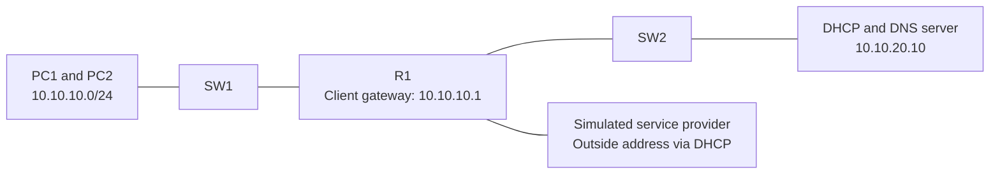

# U23 · DHCP client, server and relay

**Completion:** reported by Marcelo on 11 November 2026. He identified the supplied course-folder project as his completed version. [Saved Packet Tracer project](../packet-tracer/U23-dhcp.pkt). The walkthrough below is an original study explanation of the exercise, not a captured command transcript or an independently repeated execution test.

## Objective

Compare three DHCP roles: a router obtaining its own outside address, a router allocating addresses to local clients, and a router relaying requests to a server on another subnet. Keep address allocation separate from DNS resolution and routed connectivity.

## Scenario



This is an explanatory diagram, not an execution capture. The external DHCP server is external to R1, within the campus network; it is not an Internet DHCP service.

| Item | Exercise role |
|---|---|
| R1 FastEthernet0/0 | Outside interface, DHCP client |
| R1 FastEthernet0/1 | Client-facing gateway, 10.10.10.1/24 |
| R1 FastEthernet1/0 | Server-subnet connection, 10.10.20.1/24 |
| PC subnet | 10.10.10.0/24 |
| Reserved local addresses | 10.10.10.1 through 10.10.10.10 |
| Server | 10.10.20.10, DHCP and DNS |

Verify port names against the saved project before applying configuration. All upstream connectivity in this exercise is simulated.

## 1. R1 as a DHCP client

An IOS interface can request addressing information from an upstream DHCP server:

```text
interface FastEthernet0/0
 ip address dhcp
 no shutdown
```

These are interface-configuration commands. `ip address dhcp` requests an address; it does not configure a DHCP pool for other devices. Inspect `show ip interface brief` for the assigned address and interface state. Where supported, `show dhcp lease` provides lease and DHCP-server information. Do not infer the allocated address or server identity from the topology label alone.

## 2. R1 as the local DHCP server

For the router-server phase, reserve infrastructure addresses before defining the client pool. Representative global-configuration commands:

```text
ip dhcp excluded-address 10.10.10.1 10.10.10.10
ip dhcp pool CAMPUS_CLIENTS
 network 10.10.10.0 255.255.255.0
 default-router 10.10.10.1
 dns-server 10.10.20.10
```

The pool name is a local label. `network` defines the client subnet; `default-router` and `dns-server` supply different client options. The exclusion protects the gateway and planned static devices from allocation.

Enable DHCP on each PC under **Desktop → IP Configuration**. Check the assigned address, mask, gateway and DNS server, then compare the PC information with `show ip dhcp binding` on R1. `show ip dhcp pool` helps inspect allocation state. A lease entry alone does not establish that a client can reach a service.

## 3. Move allocation to the server subnet

The exercise removes R1's local DHCP pool, releases the client leases and checks that renewal fails before adding relay. Perform this only in an isolated working copy. Remove the intended pool rather than disabling DHCP globally; R1 must still act as the outside DHCP client and later as a relay.

The DHCP server at 10.10.20.10 has a scope for the client subnet. Initial client broadcasts do not cross R1 through ordinary IP routing. The relay belongs on the interface that receives those client broadcasts:

```text
interface FastEthernet0/1
 ip helper-address 10.10.20.10
```

The helper forwards the request to the server and provides relay information so it can select the appropriate scope. Check that the server scope supplies the client subnet's gateway, that the server has a return path through 10.10.20.1, and that no unintended competing DHCP pool remains active.

On each Packet Tracer PC, use `ipconfig /release` and `ipconfig /renew`, or the available DHCP controls. Confirm the new lease and options. With the external server serving leases, R1's local binding table is not the authoritative allocation record; inspect the server and clients.

## Verification checklist

These are repeatable review checks, not newly observed results from this publication session.

| Check | Command or action | What it establishes |
|---|---|---|
| Outside client | `show ip interface brief`; `show dhcp lease` if supported | R1's outside interface has obtained a lease |
| Router-server phase | `show ip dhcp pool`; `show ip dhcp binding` | Correct local pool and client allocations |
| Client options | PC `ipconfig` / IP Configuration | Correct address, mask, gateway and DNS |
| Relay placement | Inspect R1 FastEthernet0/1 configuration | Helper points to 10.10.20.10 on the client-facing interface |
| External server | Services → DHCP, scope and server gateway | Allocation service, suitable scope and reply path |
| Local reachability | PC → 10.10.10.1 | Client can reach its gateway |
| Server reachability | PC → 10.10.20.10 | Routed forward and return path works |
| Name resolution | PC → `DNSserver` by name | Compare name-based behavior with the numeric-IP test |

## Troubleshooting map

| Symptom | Inspect first | Correction when confirmed |
|---|---|---|
| Only one PC has no lease | PC DHCP setting, access link, renewal state | Enable DHCP or repair the affected link |
| Neither PC leases from R1 | Pool subnet, exclusions, service and interfaces | Correct the specific pool or interface error |
| Router-server works; external server fails | Client-facing helper, server service/scope, return path | Repair the missing relay or server configuration |
| Lease succeeds; remote IP fails | Client mask/gateway and routed return path | Correct addressing or routing |
| Numeric IP works; hostname fails | DNS option, server record and DNS service | Correct DNS after confirming the IP path |

## Learning focus and evidence

The useful question is **which role is failing?** A DHCP client, a DHCP server and a DHCP relay perform different jobs. Receiving an address is only the start of checking usable connectivity.

The included `.pkt` is the learner-identified saved project, preserved byte-for-byte and fingerprinted in the asset manifest. It is not proof of every intermediate release/renew test. No new lease transcript, packet capture or full execution rerun is claimed. The original Flackbox *23-1 DHCP Configuration* exercise informed this summary; its PDFs, answer key and old reference configurations are not redistributed.

- [Cisco: Configuring the Cisco IOS DHCP Relay Agent](https://www.cisco.com/c/en/us/td/docs/ios-xml/ios/ipaddr_dhcp/configuration/12-4/dhcp-12-4-book/config-dhcp-relay-agent.html)
- [Cisco: Troubleshoot DHCP in Enterprise Networks](https://www.cisco.com/c/en/us/support/docs/ip/dynamic-address-allocation-resolution/27470-100.html)

IOS command availability varies with the simulated device and Packet Tracer version.

[Course attribution](../ATTRIBUTION.md) · [Evidence scope](../docs/EVIDENCE_POLICY.md) · [Command reference](../docs/COMMANDS.md) · [Index](../README.md)
