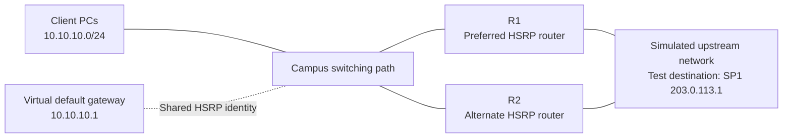

# U24 · HSRP gateway redundancy

**Completion:** reported by Marcelo on 11 November 2026. He identified the supplied course-folder project as his completed version. [Saved Packet Tracer project](../packet-tracer/U24-hsrp.pkt). The walkthrough below explains the exercise and its verification method; it is not a captured learner transcript or an independently repeated failover test.

## Objective

Give clients one virtual default gateway while two routers coordinate the active and standby roles. Distinguish initial election, priority, failover and preemption, then check both gateway reachability and the upstream path.

## Scenario



This simplifies the exercise's campus and provider topology. It is a reference diagram, not an observed forwarding path.

| Item | Exercise role |
|---|---|
| Client network | 10.10.10.0/24 |
| HSRP virtual address | 10.10.10.1 |
| R1 / R2 | Distinct physical interface addresses in the client subnet |
| Preferred router | R1, using higher priority and preemption |
| Upstream test destination | SP1 at 203.0.113.1 |

Keep each router's physical interface address unique and different from the virtual address. PCs use 10.10.10.1 as their gateway, rather than being manually moved between router addresses during a failure.

## 1. Establish the HSRP group

On both client-facing router interfaces, configure the same HSRP group and virtual IP. For example, using group 1:

```text
interface <client-facing-interface>
 standby 1 ip 10.10.10.1
```

`<client-facing-interface>` is a placeholder, not a literal IOS command. Use the actual interface and group in the project. The interfaces also need valid physical addressing and operational links.

Use `show standby brief` on both routers to identify the active router, standby router, group and virtual address. Do not assume R1 becomes active because of its name. Equal priorities and the order in which the routers join can affect which router is initially active.

## 2. Compare the physical and virtual identities

HSRP gives the group a virtual IP and a virtual MAC identity. Inspect the active router's physical interface with `show interfaces <interface>` and the HSRP details with `show standby`. On a PC, `arp -a` should associate the virtual gateway IP with the HSRP virtual MAC after relevant traffic has populated the cache.

The exact virtual MAC depends on the HSRP version and group. Read it from the project instead of copying an arbitrary value from an example. A gateway ping checks the first hop; separately test SP1 at 203.0.113.1 to assess the upstream path.

## 3. Make R1 preferred

Representative commands on R1's HSRP interface:

```text
standby 1 priority 110
standby 1 preempt
```

The default HSRP priority is 100; 110 is an illustrative higher value. Use a value above R2's configured priority for the intended preference.

**Priority and preemption are separate.** Increasing R1's priority does not by itself displace a healthy active R2. Preemption allows the higher-priority R1 to take over, subject to configured delays and protocol processing. Verify the resulting roles with `show standby brief` rather than treating the configuration text as a state report.

## 4. Test failure and restoration

Use an isolated working copy to reproduce the exercise's reload test:

1. Confirm R1 is active, R2 is standby, and both gateway and upstream tests work.
2. Start a long ping from PC1 to 10.10.10.1. The exercise uses `ping 10.10.10.1 -n 1000`; supported PC options depend on the simulator version.
3. Save R1's intended configuration before the deliberate reload. Record its role before interrupting it.
4. During the interruption, inspect R2 and confirm it becomes active. Observe actual packet loss rather than promising a particular count.
5. After R1 returns, verify that its higher priority and preemption restore the intended active role.
6. Repeat the upstream test to 203.0.113.1. A surviving virtual-gateway ping alone does not establish end-to-end service availability.

The expected transition may briefly lose packets. This page does not claim zero loss, a measured convergence time or an observed packet-loss count. `copy running-config startup-config` preserves configuration; it is not a failover test.

## Verification checklist

| Check | Command or test | What to establish |
|---|---|---|
| Router roles | `show standby brief` on R1 and R2 | One active and one standby for the intended group |
| Group details | `show standby` | Virtual IP, MAC, priority, timers and preemption |
| Physical interfaces | `show ip interface brief`; `show interfaces <interface>` | Correct physical addresses and operational state |
| Client gateway | PC IP Configuration and `arp -a` | Virtual gateway IP and corresponding virtual MAC |
| First-hop behavior | PC ping 10.10.10.1 before/during/after interruption | Gateway reachability through role changes |
| Upstream behavior | PC ping 203.0.113.1 before/after interruption | Routing beyond the gateway |
| Restoration | Role output after R1 returns | Preferred router reclaims active role when appropriate |

This table is a repeatable review checklist, not newly captured output from publication preparation.

## Troubleshooting map

| Symptom | Inspect first | Correction when confirmed |
|---|---|---|
| Both routers show active | Layer 2 connectivity, group, version and other HSRP parameters | Restore peer communication and align intended settings |
| Higher-priority R1 stays standby | Preemption and any configured delay | Enable the intended preemption policy |
| PCs lose the gateway when one router fails | PC gateway address, alternate router state and VLAN path | Use the shared virtual gateway and restore the alternate path |
| Gateway ping works; SP1 fails | Routing and upstream availability on the active router | Repair the upstream path rather than assuming HSRP covers it |
| Preferred router cannot forward upstream | Interface/routing state and tracking policy | Address the upstream fault; consider tracking as a separate extension |

## Learning focus and evidence

Two routers alone do not prove working redundancy. The useful evidence is the active/standby state and client behavior across a deliberate failure and restoration. HSRP provides first-hop redundancy; it does not replace routing or automatically detect every upstream failure.

The included `.pkt` is the learner-identified saved project, preserved byte-for-byte and fingerprinted in the asset manifest. No newly reviewed before/after role captures, continuous-ping transcript or measured failover timing accompany this addition. The original Flackbox *24-1 HSRP Configuration* exercise informed the study summary; course PDFs, answer keys and old reference configurations are not redistributed.

- [Cisco: Understand HSRP Features and Functionality](https://www.cisco.com/c/en/us/support/docs/ip/hot-standby-router-protocol-hsrp/9234-hsrpguidetoc.html)
- [Cisco: Use HSRP Preempt and Track Commands](https://www.cisco.com/c/en/us/support/docs/ip/hot-standby-router-protocol-hsrp/13780-6.html)

[Course attribution](../ATTRIBUTION.md) · [Evidence scope](../docs/EVIDENCE_POLICY.md) · [Command reference](../docs/COMMANDS.md) · [Index](../README.md)
