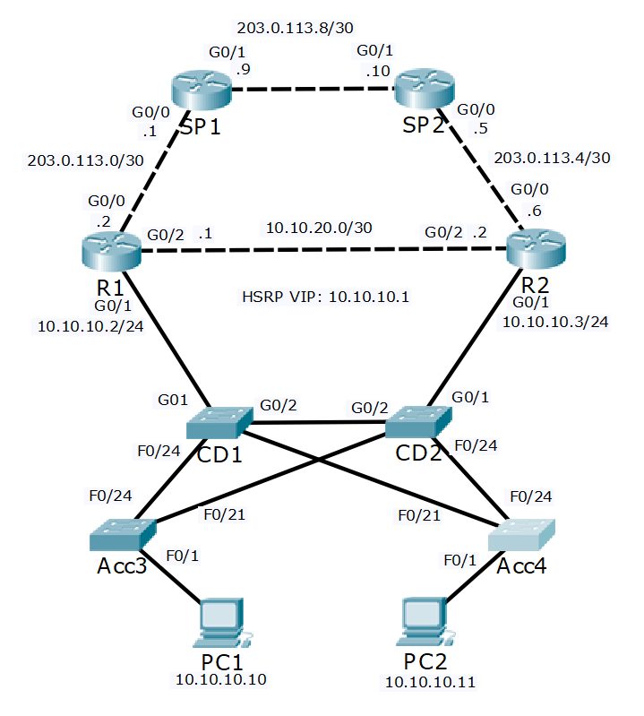

# U25.1 · STP troubleshooting

**Completion:** reported by Marcelo on 13 November 2026. [Saved Packet Tracer project](../packet-tracer/U25-1-stp-troubleshooting.pkt). The explanations below describe the course reference scenario and a repeatable investigation; no fresh device transcript or independently repeated execution is claimed.

## Objective

Explain why traffic can reach the correct Layer 3 gateway while taking an inefficient Layer 2 path. Identify the spanning-tree root, forwarding ports and learned gateway MAC before proposing a change. This troubleshooting exercise leaves the device configuration unchanged; [U25.2](U25-2-stp-configuration.md) implements the correction.

## Scenario



This supplied course diagram is shared with U25.2. It shows physical connections, not a captured forwarding state.

| Component | Role |
|---|---|
| VLAN 10 | Engineering clients, 10.10.10.0/24 |
| PC1 / PC2 | 10.10.10.10 on Acc3 / 10.10.10.11 on Acc4 |
| HSRP gateway | 10.10.10.1; R1 is the intended active router |
| CD1 / CD2 | Distribution switches attached to R1 / R2 |
| Acc3 / Acc4 | Access switches with redundant distribution uplinks |
| SP1 | Simulated upstream test destination 203.0.113.9 |

VLAN 199 is the exercise's native trunk VLAN. Check VLAN 10 consistently when comparing spanning-tree state and MAC learning.

## 1. Separate routed hops from switch forwarding

Check each PC's address, mask and virtual gateway. Ping the gateway and SP1, then use PC `tracert 203.0.113.9`. On R1 and R2, inspect `show standby brief` to establish which router currently owns the virtual gateway.

A trace can show R1 as the first routed hop while omitting the intervening switches. It cannot establish that PC2 reached CD1 through the most direct switching path. Successful reachability is a useful control test, but the question here concerns the path inside VLAN 10.

## 2. Find the actual root and port roles

Run these inspection commands on CD1, CD2, Acc3 and Acc4:

```text
show spanning-tree vlan 10
show vlan brief
show interfaces trunk
show mac address-table dynamic
```

Compare the Root ID across all four switches, then inspect each switch's own Bridge ID, root port, designated ports and alternate/blocking ports. A blocked redundant port can be normal loop prevention. Identify its role before treating it as a fault.

The course reference has Acc3 as the VLAN 10 root because its bridge ID wins the initial election. Verify this in the saved project: a switch name, location or diagram icon does not determine the root. With equal configured priorities, the MAC portion decides the bridge-ID comparison; the displayed priority can include the VLAN's extended system ID.

## 3. Follow the virtual gateway MAC

Read the virtual MAC from `show standby` on the routers. After a PC sends traffic to 10.10.10.1, compare PC `arp -a` with the switches' MAC tables. For the reference HSRP version 1, group 1, the virtual MAC is `0000.0c07.ac01`; use the actual version/group's value rather than assuming this example applies everywhere.

Locate the gateway MAC in VLAN 10 on Acc4 and follow the learned egress port toward the next switch. Repeat until reaching CD1 and the active router. The reference shows that Acc4 learns the gateway through Fa0/24 toward CD2 while its direct Fa0/21 path to CD1 is blocked.

| Reference flow | VLAN 10 forwarding path before the correction |
|---|---|
| PC1 to the active gateway | PC1 → Acc3 → CD1 → R1 |
| PC2 to the active gateway | PC2 → Acc4 → CD2 → Acc3 → CD1 → R1 |

These are reference paths from the exercise, not newly observed paths from publication preparation. In that reference, CD1 Gi0/2 toward CD2 and Acc4 Fa0/21 toward CD1 are alternate/blocking endpoints. Confirm both ends of each link and the VLAN before interpreting your own output.

## Diagnosis and next step

The access-layer root draws the spanning-tree topology away from the distribution switch attached to the active HSRP router. HSRP chooses a virtual gateway's active router; STP separately chooses the loop-free Layer 2 topology. Neither election automatically aligns the other.

Record the Root ID, blocked ports and gateway-MAC egress before changing anything. The intended correction is to make CD1 the VLAN 10 root and CD2 its backup, then verify that both access switches use the direct CD1 path. That configuration belongs to [U25.2](U25-2-stp-configuration.md), preserving this lab as the diagnosis exercise.

## Verification and troubleshooting map

| Observation | Inspect | Meaning / next action |
|---|---|---|
| Trace looks direct but client traffic detours | STP roles and gateway-MAC learning in VLAN 10 | Layer 3 trace does not expose the switch path |
| Switches appear to report different roots | Same VLAN, trunk VLAN allowance, links and convergence | Restore or explain the split Layer 2 topology |
| Gateway MAC is absent | Correct VLAN, actual HSRP MAC and recent client traffic | Generate a normal gateway ping and inspect again |
| Direct uplink is blocked | Root ID, path cost and port-role selection | Blocking can be valid even when the design is inefficient |
| Gateway role differs from the reference | `show standby brief` and router reachability | Rebuild the path from the observed active router |

## Evidence and references

The supplied `.pkt` is preserved byte-for-byte and fingerprinted in the asset manifest. The topology and reference diagnosis derive from the Flackbox *25-1 STP Troubleshooting* exercise. Full PDFs, answer keys and reference configuration bundles are excluded. No new failure/recovery captures accompany this addition.

- [Cisco: Catalyst 2960 STP configuration](https://www.cisco.com/c/en/us/td/docs/switches/lan/catalyst2960/software/release/12-2_55_se/configuration/guide/scg_2960/swstp.html)
- [Related U24 HSRP study](U24-hsrp.md)

[Course attribution](../ATTRIBUTION.md) · [Evidence scope](../docs/EVIDENCE_POLICY.md) · [Index](../README.md)
