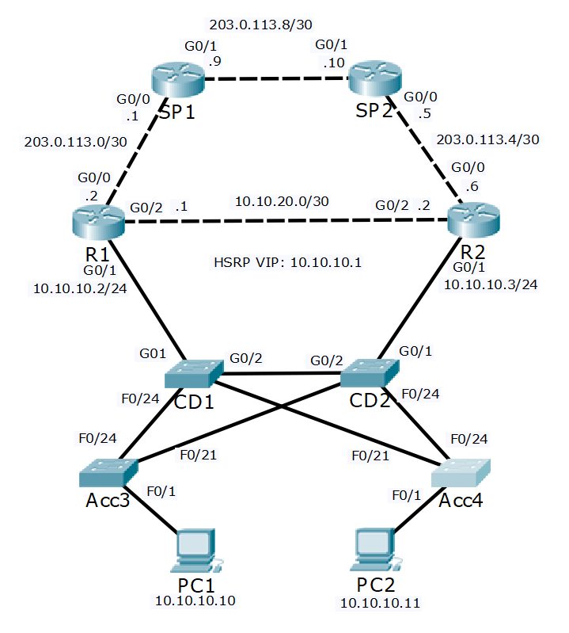

# U25.2 · Rapid PVST+ and spanning-tree protection

**Completion:** reported by Marcelo on 13 November 2026. [Saved Packet Tracer project](../packet-tracer/U25-2-stp-configuration.pkt), preserved from the supplied v1.1 project. This walkthrough explains the intended configuration and verification; it is not a newly captured execution or timed convergence test.

## Objective

Correct the Layer 2 path diagnosed in [U25.1](U25-1-stp-troubleshooting.md), align the VLAN 10 root with the preferred HSRP gateway, and apply different protections to endpoint ports and access-switch downlinks.

## Scenario



PC1 and PC2 use VLAN 10, 10.10.10.0/24, with HSRP virtual gateway 10.10.10.1. R1 connects to CD1 and is the intended active router; R2 connects to CD2. Acc3 and Acc4 each have uplinks to both distribution switches. The starting reference has Acc3 as root, producing an indirect PC2 path toward R1.

The intended correction makes CD1 primary root and CD2 secondary root for VLAN 10. Both access switches should then have a direct forwarding path toward CD1, while redundant links remain available. Preserve the exercise's HSRP and IP addressing; check actual router roles separately.

## 1. Establish Rapid PVST+

Inspect the current spanning-tree mode on CD1, CD2, Acc3 and Acc4:

```text
show spanning-tree summary
show spanning-tree vlan 10
```

In global configuration on all four campus switches, the exercise uses:

```text
spanning-tree mode rapid-pvst
```

Rapid PVST+ runs a rapid spanning-tree instance per VLAN. Verify the resulting mode and port roles after convergence. Do not infer a measured improvement from enabling the feature; convergence behavior depends on the links, peers and event, and no timing measurement is included here.

## 2. Place the root beside the preferred gateway

On CD1:

```text
spanning-tree vlan 10 root primary
```

On CD2:

```text
spanning-tree vlan 10 root secondary
```

These commands set bridge priorities for the intended hierarchy. They do not create a permanent guarantee against every future lower bridge ID. Compare actual Root IDs and Bridge IDs; the displayed priority can include the VLAN's extended system ID.

| Intended role | What to establish |
|---|---|
| CD1 | Root for VLAN 10; its Root ID matches its own Bridge ID |
| CD2 | Backup root preference; valid path toward CD1 in normal operation |
| Acc3 and Acc4 | Root ports point toward CD1 through their direct links |
| Client traffic | PC1 → Acc3 → CD1 → R1; PC2 → Acc4 → CD1 → R1 |

Those paths describe the reference target. Verify HSRP with `show standby brief` and follow the actual gateway MAC through the switch tables; an STP root change does not itself change the active HSRP router.

## 3. Configure endpoint edge ports

Apply PortFast and BPDU Guard to the exercise's endpoint-facing access ports:

| Switch | Endpoint port | Attached device |
|---|---|---|
| Acc3 | FastEthernet0/1 | PC1 |
| Acc4 | FastEthernet0/1 | PC2 |
| CD1 | GigabitEthernet0/1 | R1 routed interface |
| CD2 | GigabitEthernet0/1 | R2 routed interface |

For each selected port, use interface configuration:

```text
spanning-tree portfast
spanning-tree bpduguard enable
```

Confirm the attached router interface is a routed endpoint rather than a bridge before treating it as an edge. Do not apply this edge configuration to the inter-switch trunks.

PortFast lets an endpoint port enter forwarding promptly. BPDU Guard puts the protected port into an error-disabled state if it receives a BPDU. Inspect the unexpected attachment or bridging behavior before recovering a port; disabling the protection is not the diagnosis. Confirm supported commands on the simulated switch model.

## 4. Keep access switches from taking the root role

On both CD1 and CD2, select the downlinks to Acc3/Acc4:

```text
interface range FastEthernet0/21, FastEthernet0/24
 spanning-tree guard root
```

If the simulator rejects that range syntax, configure the two interfaces individually. Check the diagram and neighbor information before applying the commands. Root Guard belongs on these distribution-to-access downlinks in this design. Do not put it on CD2's GigabitEthernet0/2 link toward CD1, where receiving the legitimate root information is necessary.

A superior BPDU on a Root Guard port causes a root-inconsistent blocked state; recovery follows when superior BPDUs stop. This differs from BPDU Guard's error-disable behavior on an endpoint port. The two features enforce different assumptions about what belongs on the link.

## Verification and troubleshooting map

| Check | Command / method | Intended result or interpretation |
|---|---|---|
| Protocol mode | `show spanning-tree summary` | Rapid PVST+ on all four switches |
| Root placement | `show spanning-tree vlan 10` | CD1 root; access root ports point toward CD1 |
| Per-port settings | `show running-config`; supported `show spanning-tree interface <port> detail` | Edge/BPDU Guard and Root Guard applied to the intended ports |
| Inconsistent ports | `show spanning-tree inconsistentports`, where supported | Explain any root-inconsistent condition before removing a guard |
| HSRP state | `show standby brief` on R1/R2 | Intended active/standby router roles remain intact |
| Forwarding path | Generate gateway traffic, inspect PC ARP and VLAN 10 MAC tables | Gateway MAC learned through the direct CD1 path |
| Reachability | Ping 10.10.10.1 and 203.0.113.9 from both PCs | Local gateway and simulated upstream tested separately |
| Persistence | `copy running-config startup-config`; save working `.pkt` | Preserve configuration and simulator project separately |

If a port goes error-disabled, inspect for a received BPDU and an unexpected bridge. If a downlink becomes root-inconsistent, inspect the advertised superior root. If CD2 loses its legitimate path to CD1, check whether Root Guard was placed on the inter-distribution link by mistake.

For an optional isolated failure test, record baseline roles and connectivity, interrupt one intended path, inspect the actual replacement roles/path, then restore and verify. No packet-loss count, convergence time or new failover result is asserted by this page.

## Evidence and references

The `.pkt` and shared source topology are fingerprinted in the asset manifest. The original study summary follows Flackbox *25-2 STP Configuration v1.1*. Full course PDFs, answer keys and reference configuration bundles are excluded; there are no newly captured before/after device outputs for this addition.

- [Cisco: Catalyst 2960 STP configuration and root commands](https://www.cisco.com/c/en/us/td/docs/switches/lan/catalyst2960/software/release/12-2_55_se/configuration/guide/scg_2960/swstp.html)
- [Cisco: Understand Spanning Tree PortFast and BPDU Guard Features](https://www.cisco.com/c/en/us/support/docs/lan-switching/spanning-tree-protocol/10586-65.html)
- [Cisco: Catalyst 2960 spanning-tree guard command](https://www.cisco.com/c/en/us/td/docs/switches/lan/catalyst2960/software/release/15-2_4_e/command/reference/cr_2960/cli3.html)

[Course attribution](../ATTRIBUTION.md) · [Evidence scope](../docs/EVIDENCE_POLICY.md) · [Command reference](../docs/COMMANDS.md) · [Index](../README.md)
