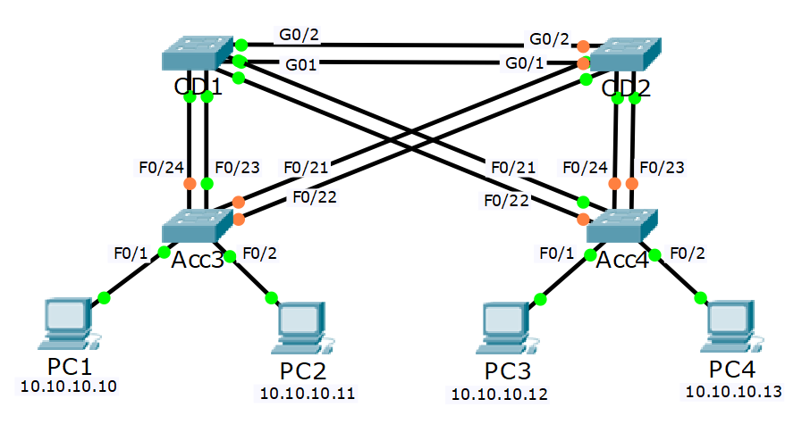
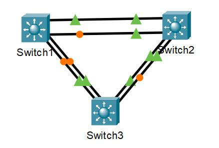

# U26.1 · EtherChannel: LACP, PAgP and routed port channels

**Source:** Flackbox/Udemy section 26.1. [Packet Tracer project](../packet-tracer/U26-1-etherchannel.pkt). Added following the learner's 16 November 2026 publication request. The configuration examples explain the supplied exercise; verification results below are targets to check, not a newly captured execution transcript.

## Objective and starting point

Combine parallel switch links into logical interfaces, compare three channel modes, and then use routed EtherChannels for OSPF. Open a working copy of the supplied project and inspect its existing configuration before changing it.

### Layer 2 campus



Acc3 serves PC1/PC2; Acc4 serves PC3/PC4. The clients use 10.10.10.10–13. Each access switch has two physical links to each distribution switch. CD1 and CD2 also have two GigabitEthernet links between them. These distribution switches are independent devices: keep the links to each peer in separate bundles.

The reference uses native VLAN 199 on the trunks. Preserve the exercise's VLANs and allowed VLAN lists, and make the member ports and logical interfaces consistent at both ends.

| Local switch | Physical members | Peer and matching members | Local port channel | Mode on both ends |
|---|---|---|---|---|
| Acc3 | Fa0/23–24 | CD1 Fa0/23–24 | Po1 | LACP `active` |
| Acc3 | Fa0/21–22 | CD2 Fa0/21–22 | Po2 | LACP `active` |
| Acc4 | Fa0/23–24 | CD2 Fa0/23–24 | Po1 | PAgP `desirable` |
| Acc4 | Fa0/21–22 | CD1 Fa0/21–22 | Po2 | PAgP `desirable` |
| CD1 | Gi0/1–2 | CD2 Gi0/1–2 | Po3 | Static `on` |

The matching peer uses the same Po number in this exercise for readability. Channel numbers are local identifiers; matching numbers do not compensate for incompatible settings.

## Configure and understand a Layer 2 bundle

Example for Acc3 toward CD1, starting in privileged EXEC. Apply the matching configuration on CD1, with a description identifying Acc3:

```text
configure terminal
interface range FastEthernet0/23 - 24
 switchport mode trunk
 switchport trunk native vlan 199
 channel-group 1 mode active
 no shutdown
exit
interface Port-channel1
 description Uplink to CD1
 switchport mode trunk
 switchport trunk native vlan 199
 no shutdown
end
show etherchannel summary
show interfaces trunk
show spanning-tree vlan 10
```

Repeat the procedure using the peer/member/channel table. For Acc4's links use `mode desirable`; for the distribution pair use `mode on`. The latter has no negotiation, so verify the intended physical peers and consistent configuration before enabling it. Do not mix `on` at one end with LACP or PAgP at the other.

| Command / context | Why it is used | What to check |
|---|---|---|
| `interface range ...` · global configuration | Select the physical members together | Select only links terminating on the same logical peer |
| `channel-group 1 mode active` · member interfaces | Initiate LACP negotiation and associate members with Po1 | LACP needs at least one active end; passive/passive does not initiate |
| `channel-group 1 mode desirable` · member interfaces | Initiate Cisco PAgP negotiation | Desirable/desirable or desirable/auto; auto/auto does not initiate |
| `channel-group 3 mode on` · member interfaces | Force a static bundle | No negotiation detects an incompatible peer |
| `interface Port-channel1` · global configuration | Configure the logical bundle | Keep trunk/native/allowed VLAN settings consistent with its members |
| `show etherchannel summary` · EXEC | Inspect protocol, logical state and membership | Layer 2 normally shows `SU`, with intended members marked `P`; read the displayed flag legend |
| `show interfaces trunk` · EXEC | Verify operational trunks and VLAN handling | A bundle can exist while the needed VLAN is not carried |
| `show spanning-tree vlan 10` · EXEC | Check which logical paths forward for VLAN 10 | STP still prevents loops between separate Layer 2 port channels |

### Bandwidth and STP interpretation

Before bundling, the reference's forwarding access uplink has one 100 Mbps FastEthernet member. With both members bundled and forwarding, that access port channel offers 200 Mbps aggregate capacity per direction. This is a capacity explanation, not a throughput measurement. The path still has endpoint and other link limits, and one flow is normally assigned to one member by the hashing policy rather than using both links at once.

STP treats a Layer 2 port channel as one logical link. An alternate port channel can remain blocked for a VLAN while its physical members are correctly bundled. A blocked alternate path is different from a failed EtherChannel. Inspect actual Root ID and port roles rather than assuming CD1 is root from the diagram alone.

## Routed EtherChannels and OSPF

The separate three-switch topology changes the problem: its bundles carry routed IPv4 links rather than VLAN trunks.



The diagram illustrates the cabling, not a captured final forwarding state. Its starting link colours do not establish post-configuration STP or OSPF behavior.

| Peers | Members on both peers | Logical interface | First peer IP | Second peer IP | Subnet |
|---|---|---|---|---|---|
| Switch1 ↔ Switch2 | Gi1/0/1–2 | Po1 | 192.168.0.1/30 | 192.168.0.2/30 | 192.168.0.0/30 |
| Switch1 ↔ Switch3 | Gi1/0/3–4 | Po2 | 192.168.0.5/30 | 192.168.0.6/30 | 192.168.0.4/30 |
| Switch2 ↔ Switch3 | Gi1/0/5–6 | Po3 | 192.168.0.9/30 | 192.168.0.10/30 | 192.168.0.8/30 |

Example on Switch1 toward Switch2:

```text
configure terminal
ip routing
interface range GigabitEthernet1/0/1 - 2
 no switchport
 channel-group 1 mode active
 no shutdown
exit
interface Port-channel1
 no switchport
 ip address 192.168.0.1 255.255.255.252
 no shutdown
exit
router ospf 1
 network 192.168.0.0 0.0.0.255 area 0
end
```

Use the table to configure both ends of all three bundles, with LACP active and the appropriate channel number/IP. Put the subnet address on the logical port channel, not on individual members. Enable `ip routing` and the OSPF process on all three switches. The OSPF network command selects matching interface addresses; it is not a static route and does not create connectivity by itself.

`no switchport` selects routed operation. A routed bundle normally appears as `RU` in the summary; members should be `P`. Those Layer 3 interfaces do not participate in STP. Any unrelated Layer 2 interfaces must still be considered separately.

Run these checks from EXEC on all three switches:

```text
show etherchannel summary
show ip interface brief
show interfaces Port-channel1
show ip ospf neighbor
show ip route
show spanning-tree
```

Check the other port-channel numbers as appropriate. First ping each directly connected peer IP, then an address on the third switch. Verify the expected OSPF neighbors and learned remote /30 network. A broadcast OSPF link can elect DR/BDR; do not require every interface to display the same role. Save with `copy running-config startup-config` and save the working `.pkt` separately.

## Troubleshooting map

These are reference diagnoses for reproducing and checking the exercise, not claims that each failure occurred in the learner's run.

| Symptom | Inspect | Correction and validation |
|---|---|---|
| Members remain individual or suspended | Summary flags, peer cabling, protocol/mode and member settings | Align negotiation and speed/duplex/trunk/VLAN settings; verify `P` on both ends |
| LACP or PAgP never forms | Both ends passive, both ends auto, or different protocols | Use a compatible pair; recheck negotiated protocol and membership |
| Channel is up but a VLAN fails | Trunk/native/allowed VLANs, VLAN existence and STP state | Restore the intended VLAN handling; test that VLAN through the selected path |
| Redundant Po is blocked | Per-VLAN root and port roles | Confirm a loop-free alternate; do not disable STP to force all paths forward |
| Routed Po is up but no remote routes appear | Po addresses/masks, `ip routing`, OSPF interface selection and neighbors | Correct the Layer 3/OSPF setting, then verify neighbor, route and ping separately |
| Expected “double speed” is absent | Number of bundled members, flow hash and endpoint link speed | Distinguish aggregate capacity from a single-flow or endpoint bottleneck |

For an optional isolated resilience test, save a known working copy, shut one physical member, and inspect whether the remaining bundle stays usable. Restore that member with `no shutdown` and check membership and connectivity again. Do not shut the entire port channel when testing one member. No failover time or packet-loss result was captured for this publication.

## Evidence and references

One supplied `.pkt` and two distinct course reference diagrams are preserved with fingerprints. Full course PDFs, answer keys and reference configuration bundles are excluded. The project was not opened or independently rerun during this repository update, and no learner CLI captures were supplied for this addition.

- [Cisco: Catalyst 3650 EtherChannel configuration, modes and routed bundles](https://www.cisco.com/c/en/us/td/docs/switches/lan/catalyst3650/software/release/37e/consolidated_guide/b_37e_consolidated_3650_cg/configuring_etherchannels.html)
- [Previous lab: STP configuration](U25-2-stp-configuration.md)
- [Attribution](../ATTRIBUTION.md) · [Evidence scope](../docs/EVIDENCE_POLICY.md) · [Index](../README.md)
