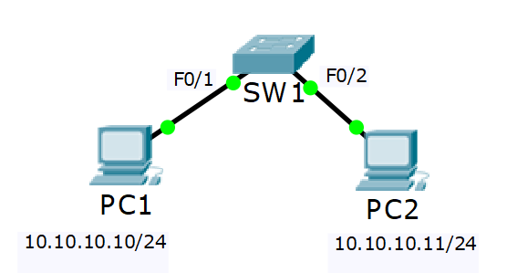

# U27.1 · Switch port security: configured and learned MAC addresses

**Source:** Flackbox/Udemy section 27.1, Port Security Configuration. [Packet Tracer project](../packet-tracer/U27-1-port-security.pkt). This guide explains the supplied exercise and provides checks to reproduce it. Expected states below are reference targets, not a newly captured execution transcript.

## Objective and topology

Disable unused switch interfaces, configure two different secure access ports and verify their operational state without relying on `show running-config`.



| Device | SW1 interface | IPv4 address | Exercise MAC address | Intended policy |
|---|---|---|---|---|
| PC1 | Fa0/1 | 10.10.10.10/24 | `0000.1111.1111` | Maximum two secure addresses; configure PC1 manually |
| PC2 | Fa0/2 | 10.10.10.11/24 | `0000.2222.2222` | Default maximum of one; learn the source dynamically |

The PCs share the same subnet and VLAN 1 in this exercise; their local traffic does not require a router. Confirm the actual NIC addresses and existing switch settings in a working copy of the project before configuring it. The supplied topology image illustrates the connections, not a verified final security state.

## 1. Disable the unused interfaces

On this 24-port switch, only Fa0/1 and Fa0/2 are used. From privileged EXEC:

```text
configure terminal
interface range FastEthernet0/3 - 24
 shutdown
exit
interface range GigabitEthernet0/1 - 2
 shutdown
end
show interfaces status
```

Check the cabling first: apply these ranges only to this isolated topology. Unused ports should be administratively disabled; keep both PC-facing interfaces available for the exercise.

## 2. Configure PC1's secure access port before generating traffic

Keep Fa0/1 shut while installing the static secure address. This prevents PC1's background traffic from learning the same address dynamically first in Packet Tracer.

```text
configure terminal
interface FastEthernet0/1
 shutdown
 switchport mode access
 switchport port-security
 switchport port-security maximum 2
 switchport port-security mac-address 0000.1111.1111
 no shutdown
end
```

The maximum counts all secure addresses on the port. One manually configured address with a maximum of two leaves room for one additional dynamically learned source. It does **not** restrict this port exclusively to PC1. Neither a MAC limit nor a configured MAC authenticates a user; this lab does not configure 802.1X.

## 3. Enable default port security on PC2's access port

```text
configure terminal
interface FastEthernet0/2
 switchport mode access
 switchport port-security
 no shutdown
end
```

For this exercise the defaults are one secure MAC address and violation mode `shutdown`. No static address or sticky learning is configured on Fa0/2. The first source learned after enabling security occupies its one available slot. Dynamic learning here is different from `switchport port-security mac-address sticky`.

After configuring both ports, generate traffic from PC1:

```text
ping 10.10.10.11
```

Allow ARP resolution and retry if the first ping is lost. A successful ping checks communication; it does not by itself prove the intended security settings.

## 4. Inspect the operational security state

Run on SW1 from EXEC, without using `show running-config` for this task:

```text
show port-security
show port-security address
show port-security interface FastEthernet0/1
show port-security interface FastEthernet0/2
show interfaces status
```

| Check after normal PC traffic | Fa0/1 reference target | Fa0/2 reference target |
|---|---|---|
| Port security / port status | Enabled / Secure-up | Enabled / Secure-up |
| Maximum secure addresses | 2 | 1 |
| Total secure addresses | 1, if only PC1 has transmitted on this port | 1, after PC2 has transmitted |
| Configured secure addresses | 1 | 0 |
| Sticky addresses | 0 | 0 |
| Address and type | PC1, `SecureConfigured` | PC2, `SecureDynamic` |
| Violation mode | Shutdown | Shutdown |
| Violation count | 0 in the normal reference state | 0 in the normal reference state |

Read actual output rather than assuming a counter value. If another source has already been learned, investigate it before comparing totals. Use `show port-security address` for the secure address types; the ordinary MAC forwarding table alone does not establish the security policy.

Once verified, save the switch configuration with `copy running-config startup-config` and save the working `.pkt` separately. A dynamic secure entry is not converted into an explicit configured MAC by saving the configuration.

## Troubleshooting map

These are reference diagnoses for reproducing the exercise, not claims that each fault occurred in a learner run.

| Symptom | Inspect | Correction and validation |
|---|---|---|
| Enabling security is rejected | Administrative switchport mode | Select the intended access interface and apply `switchport mode access`; retry and inspect security state |
| `Found duplicate mac-address` when adding PC1 | Whether PC1 was learned dynamically before the static command | In the course's Packet Tracer workaround, shut Fa0/1, save and reload, then add PC1's static secure MAC while the port is still shut; finally enable it and verify the address type |
| PC2's secure address is absent | Link state and whether PC2 has sent a frame | Generate traffic, then recheck the secure address table and Fa0/2 counters |
| Port becomes Secure-shutdown / error-disabled | Last source, address limit and violation count | Remove the unexpected source or correct the intended policy first; use `shutdown` then `no shutdown` on that interface and verify recovery |
| A second source is accepted on Fa0/1 | Maximum two, with only one static secure address | This is allowed by this lab's policy; compare the configured maximum with the intended requirement |
| Ping fails while security looks normal | PC IP/mask, VLAN, cabling, administrative and operational state | Check the local forwarding path as well as security; retry after ARP resolution |

The duplicate-address recovery above is the supplied exercise's simulator workaround, not a statement that all IOS platforms require a reload. Actual devices and releases have different clearing commands and supported syntax. Do not reload a production switch based on this lab.

An optional violation experiment should use a separate saved simulator copy. Fa0/1 requires enough additional source MAC addresses to exceed its maximum of two; simply adding a second source need not trigger it. Record the before/fault/recovered states if testing. No such violation or recovery run was captured for this publication.

## Evidence and references

The supplied `.pkt` and course topology image are preserved byte-for-byte with SHA-256 fingerprints in the [asset manifest](../asset-manifest.json). The project was not opened or independently rerun for this repository addition. No learner CLI screenshots were present in this source folder. Full course PDFs, the answer key and reference configuration files are excluded; the walkthrough above is an explanatory study guide.

- [Cisco: Catalyst 2960 port security configuration and defaults](https://www.cisco.com/c/en/us/td/docs/switches/lan/catalyst2960/software/release/12-2_53_se/configuration/guide/2960scg/swtrafc.html)
- [Previous lab: EtherChannel](U26-1-etherchannel.md)
- [Attribution](../ATTRIBUTION.md) · [Repository index](../README.md)
